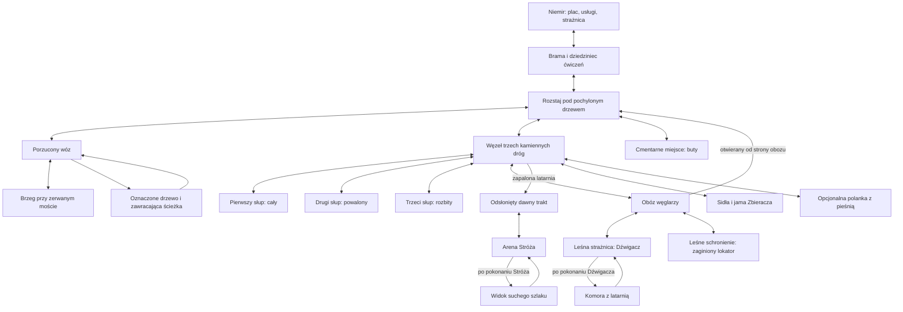
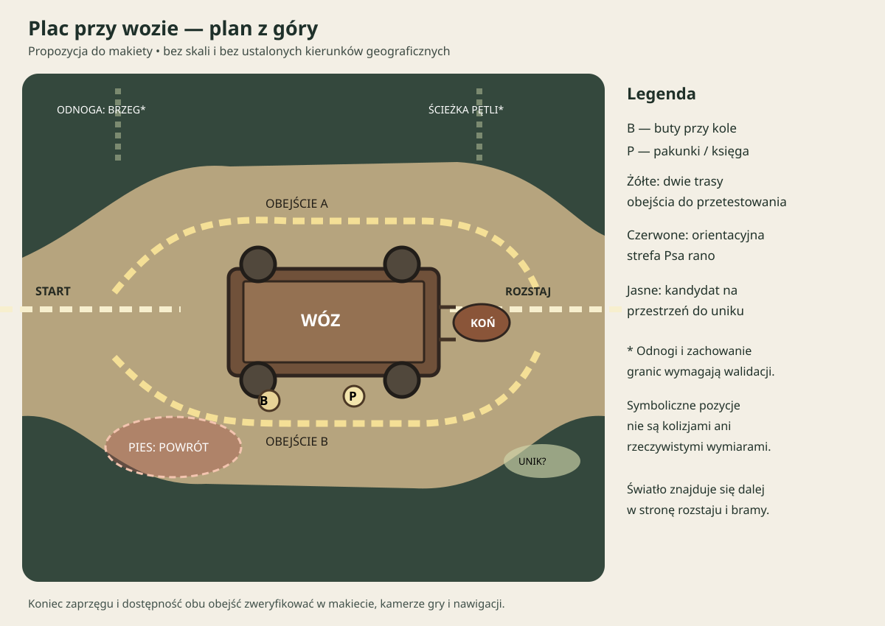

# Mapa demo — Niemir, las, początek gry i plac przy wozie (pakiet 04)

Status: propozycja (pakiet 04). Pełna topologia doliny: [mapa świata v0.2](world/README.md).
Powiązania: [fabuła](fabula.md), [przeciwnicy](przeciwnicy.md), [mechaniki](mechaniki.md).

## Część I — Niemir, las i przebieg demo

### 1. Kształt całości

Niemir jest niewielką osadą wciśniętą między skałę ze źródłem a gęsty las. Jedna główna brama daje czytelny punkt powrotu. Po zewnętrznej stronie palisady biegnie krótka ścieżka gospodarcza; nie otwiera drugiego wyjścia z doliny. W obrębie palisady nie projektujemy walk ani obowiązkowego labiryntu wnętrz.

Las układa się w trzy powiązane obszary: **skraj z wozem**, **bór z kamieniami i odnogami**, **obóz i leśne ruiny**. To opis funkcjonalny, nie nowe nazwy własne. Zwykłe drogi dają się zapamiętać; nadprzyrodzone zawracanie występuje w konkretnych miejscach, nie losowo na każdym rozstaju.

Nie ma pól, rozległych miejskich placów, sieci podziemi pod każdym domem ani dalekich panoram świata. Gracz widzi tyle, ile może poznać podczas demo.

### 2. Schemat połączeń

Schemat jest topologiczny: pokazuje relacje, nie gotowy kształt terenu, skalę ani kierunki geograficzne.



Niemir jest punktem przygotowania, odpoczynku i rozliczenia. Drogę do finału otwiera latarnia zapalona w strażnicy osady, nie sam fakt podniesienia pustej lampy w ruinach. Powrót z latarnią korzysta ze skrótu przy obozie.

### 3. Obie strażnice

- **ZON-straznica-niemir:** budynek wewnątrz osady, wspólna latarnia, Wszebora, bezpieczeństwo. Kamienny fundament, lekka drewniana góra, mała sylwetka pionowa.
- **ZON-straznica-lesna:** zrujnowany obiekt przy dawnym trakcie; piec, Dźwigacz i komora przenośnej latarni. Ciężka, niska sylwetka przerwana zawalonym murem.
- Arena Stróża znajduje się dalej przy tym samym kompleksie dawnych ruin, ale dochodzi się do niej odsłoniętą drogą między słupami. Nie ma dostępnej wcześniej szczeliny z komory do końca demo.

Nie ustanawiamy jeszcze wspólnego budowniczego ani daty powstania obiektów.

### 4. Niemir — usługi, ludzie i orientacja

| Strefa | Wejście i połączenia | Funkcja i prowadzenie wzroku | Proponowani mieszkańcy |
|---|---|---|---|
| Brama, ZON-brama | Rozstaj ↔ plac | Jedyny główny powrót; ciepłe światło ponad bramą, rzemienie pod dachem | Żegota; Nawoja przed wyprawami; Czcibor jako jeden z pierwszych informatorów |
| Dziedziniec, ZON-dziedziniec | Brama ↔ kuźnia | Ubita ziemia, trening bez ryzyka, wyraźnie otwarty środek | Żegota podczas ćwiczeń |
| Plac przy źródle, ZON-plac | Brama ↔ usługi ↔ strażnica | Skała i woda jako stały punkt orientacyjny; miejsce na wozy, nie monumentalny rynek | Domarad, Sambor, Milorad |
| Dom kupca ze składem, ZON-sklad [DECYZJA AUTORA, 28.10.2026] | Bezpośrednio przy placu | Największy dom w osadzie z przylegającym składem; pozostali kupcy rozkładają towar na placu | Kupiec, gospodarz składu |
| Dom gościnny, ZON-dom-goscinny | Bezpośrednio przy placu | Nocleg, zapis i powrót po wyprawie; ława dla gości przy wejściu | Miłka, Sulir |
| Kuźnia i chata zielarki, ZON-uslugi | Plac ↔ dziedziniec | Dwa odrębne domy po tej samej stronie placu; ogień i suszące się zioła | Radost, Dobrawa |
| Strażnica osady, ZON-straznica-niemir | Plac; dojście bez zagadki | Wspólna latarnia i krótka wizyta przy powrocie z ruin | Wszebora |
| Domy przy palisadzie, ZON-domy | Krótka pętla wracająca do placu | Prywatność, żałoba, ślady życia; bez przeszukiwania kilkunastu pustych wnętrz | Dzierżka, Mściwuj, Borzęta, Wojsława |

**Czcibor** [DECYZJA AUTORA, 28.10.2026] jest łowcą i jednym z pierwszych informatorów gracza, nie zaginionym lokatorem. Lokatorem z „Trzeciego przy stole” jest wędrowny cieśla Uniegost.

Nie wprowadzamy w demie swobodnego zabijania NPC: LPM na mieszkańcu inicjuje interakcję, nie wrogi cios. To propozycja zakresu i ochrony zadań, nie reguła świata, że mieszkańcy są nieśmiertelni. Nauka parady z Żegotą działa w osobnym, bezpiecznym ćwiczeniu.

Pierwszy nocleg jest miejscem przy wspólnym ogniu na kredyt za odzyskanie pakunków. Późniejsza nagroda za „Trzeciego przy stole” to prywatna izba, więc oba wydarzenia nie przyznają tego samego dostępu po raz drugi.

### 5. Karty obszarów lasu

Wymiary są funkcjonalne, nie w metrach. Zasady rozmiaru są w sekcji 8.

| ID / miejsce | Cel, wejście i wyjścia | Narzędzia przestrzenne i slot spotkania | Prowadzenie / intensywność |
|---|---|---|---|
| ZON-rozstaj | Brama, wóz, kamienie, cmentarne miejsce, późniejszy skrót z obozu | Szeroki węzeł bez stałego starcia; widoczne rozdzielenie kierunków | Pochylone drzewo, w tle światło bramy; 1 |
| ZON-woz | Rozstaj ↔ brzeg; pętla ścieżki wraca do wozu | Otwarty plac wokół wozu, dwie drogi obejścia, slot ENC-woz | Koń, koło i jasny pakunek widoczne przed wrogami; 2–3 |
| ZON-brzeg | Odnoga od wozu, powrót tą samą drogą | Złamany most, bez skoku nad wyrwą i bez wymaganej walki | Szum wody i widoczny drugi przyczółek; 1 |
| ZON-petla | Wóz → oznaczone drzewo → ten sam wóz | Krótka, rozpoznawalna pętla; bez losowego przestawiania mapy | Ten sam znak nacięcia i ten sam rekwizyt wozu; 2 |
| ZON-kamienie | Rozstaj ↔ trzy odnogi ze słupami ↔ obóz i odnogi poboczne | Każdy słup ma dojście z boku; slot ENC-kamienie nie blokuje wszystkich śladów | Odmienny stan każdego słupa; 2–3 |
| ZON-oboz | Kamienie ↔ ruiny; schronienie i otwierany skrót | Stos drewna dzielący linię ostrzału, oba boki drożne; ENC-oboz | Dym resztkowy, nie wesołe ognisko; 3 |
| ZON-straznica-lesna | Obóz ↔ arena Dźwigacza ↔ komora po zwycięstwie | Dwa obejścia filara; boss ma przejście po obu stronach | Piec i ruch nosidła; 4 |
| ZON-komora | Strażnica leśna; bez alternatywnego wyjścia za Stróża | Krótka, bezpieczna nagroda po walce | Zimna lampa, ciała zwrócone do zamurowanego przejścia; 1 |
| ZON-dawny-trakt | Węzeł kamieni ↔ arena Stróża, dostęp z zapaloną latarnią | Proste dojście na finał bez obowiązkowej powtórki wrogów | Słupy wyłaniające się ze światła; 2 |
| ZON-stroz | Dawny trakt ↔ suchy szlak po zwycięstwie | Arena opisana w pakiecie 03; brak ślepych wnęk i nieosiągalnych półek | Poprzecznie trzymane drzewce; 5 |
| ZON-suchy-szlak | Krótki odcinek za Stróżem; powrót do osady znaną drogą | Punkt potwierdzenia odkrycia, nie nowa mapa świata | Twarde podłoże i dalsza droga niknąca za drzewami; 1 |

Rozstaje mają rozpoznawalne sylwetki. Nie dekorujemy wszystkich identycznymi słupami, latarniami i zwłokami: wyjątkowe znaki muszą zachować znaczenie.

### 6. Odnogi poboczne

| Odnoga | Początek / powrót | Zawartość i nagroda | Niezależność |
|---|---|---|---|
| ZON-cmentarne-miejsce | Rozstaj ↔ miejsce przy leśnej skale | „Nie pal jego butów”; przedmiot i wiadomość, nie obowiązkowy miniboss | Żaden element nie otwiera głównej drogi |
| ZON-sidla i ZON-jama | Kamienie ↔ ślady sideł ↔ Zbieracz | „Puste sidła”; odzyskanie zapasów i rozliczenie z łowczynią Wojsławą [DECYZJA AUTORA, 28.10.2026] | Finał możliwy bez walki |
| Narzędzia przy obozie | Odgałęzienie na trasie przez obóz, powrót przy skrócie | „Żelazo pod korą”; narzędzia i usługa Radosta | Dźwigacz nie wymaga naprawy ani zakupu nowej broni |
| ZON-schronienie | Obóz ↔ mały szałas bez nowego lochu | „Trzeci przy stole”; odnalezienie Uniegosta, rozmowa i prywatna izba | Nie jest źródłem jedynej wskazówki o latarni |
| ZON-piesn | Kamienie ↔ niewielka polanka, powrót tą samą ścieżką | ENC-piesn, ślad i przygotowane drobne znalezisko | Bez nowego zadania wymaganego do ukończenia demo |

Odnaleziony Uniegost wraca do gospody po rozmowie po zakończeniu bezpośredniego zagrożenia; nie projektujemy dodatkowej eskorty z własną śmiercią NPC. Przedmioty znalezione wcześniej są rozpoznawane przy późniejszym przyjęciu zadania.

### 7. Droga główna i powroty

1. **Podejście:** prolog przy wozie → brama → nocleg.
2. **Pierwsza wyprawa:** poranna informacja o moście → bezpieczna próba sterowania → wóz → odzyskanie pakunków i obserwacja pętli → powrót.
3. **Badanie lasu:** trzy słupy w dowolnej kolejności → ślady rozbicia → rozmowa z Borzętą. Rozmowa daje kontekst, a nie niewidzialny zamek uniemożliwiający wcześniejsze odwiedzenie obozu.
4. **Dłuższa wyprawa:** obóz → Dźwigacz → komora z latarnią → skrót od strony obozu → Wszebora i zapalenie lampy w Niemirze.
5. **Finał:** kamienie → odsłonięty trakt → Stróż → potwierdzenie suchej drogi → powrót z wiadomością.

**Zasada powrotu [DECYZJA AUTORA, 28.10.2026]:** po przejściu lochu lub dłuższej odnogi gracz nie wraca tą samą, już pustą drogą. Otwiera się krótsze, alternatywne przejście do początku wyprawy (bliżej osady lub rozstaju), przy którym może leżeć drobna nagroda. Wzorem jest Skyrim; skrót od strony obozu jest pierwszym przykładem.

Przejścia wymagane: pokonany Dźwigacz otwiera komorę; latarnia zapalona w osadzie odsłania trakt; pokonany Stróż otwiera suchą drogę. Żaden z tych warunków nie zależy od losowego łupu, pobocznego bossa, zużywalnej pochodni ani poziomu umiejętności.

Pętla lasu działa tylko na wyraźnie wskazanym dawnym wyjściu. Nie przenosi bohatera podczas walki, nie resetuje zapasów ani wrogów, nie odbiera kursora i nie usuwa znaku na drzewie. Odkryta ścieżka powrotna do osady pozostaje stabilna.

### 8. Metryki do projektu z prostych brył

Najpierw należy zmierzyć w prototypie: D — średnicę kolizji bohatera, B — największy obrys lokalnego przeciwnika, U — pełny dystans uniku, A — zasięg jego groźnego ataku, V — widoczny obszar podłoża w kamerze. Nie ustalamy metrów przed tym pomiarem.

- Zwykłe drzwi: przejście większe niż D z marginesem dla sterowania kliknięciem; brak zaczepiania o dekoracje.
- Przejścia używane do omijania bossa: większe niż B z marginesem na obrót i nawigację, po obu stronach przeszkody.
- Pole nauki uniku: pełny tor U plus bezpieczny obszar startu i zakończenia; żadnego drzewa kończącego pierwszy odskok.
- Arena: umożliwia wyjście poza A pełnym lub częściowym U; nie wymaga podwójnego uniku jako jedynej odpowiedzi. Jeśli zmienimy U, wracamy do testu areny.
- Wóz i stos drewna: faktyczna kolizja zatrzymuje również pociski; droga obejścia jest dostępna dla odpowiedniego przeciwnika.
- Walka musi mieścić czytelną zapowiedź w V. Kamera i odsłanianie koron drzew są częścią projektu, nie kosmetyką.
- Głębokie urwiska są granicą terenu. Nie dodajemy skoku, wspinania ani obrażeń od upadku do wymagań pierwszej wyprawy.

Warunki odbioru mają wykazać brak klinowania ruchu, dostępność obu obejść i widoczność zapowiedzi.

### 9. Zakres pierwszego grywalnego fragmentu

**Brama i mały fragment osady → rozstaj → plac przy wozie → powrót do Żegoty.** Potrzebne są: jedno miejsce ćwiczeń, Pies, Powrotnik jako drugi krok, przedmiot zadania, rozmowa rozliczenia, zapis i ponowne wczytanie. Zależności oraz kolejność budowy opisuje początek gry.

Pełna osada, wszystkie sklepy, trzy słupy, Dźwigacz i Stróż nie są warunkiem pierwszego testu pętli. Ich miejsca pozostają zaprojektowane, ale nie muszą zostać zbudowane naraz.

Grafy: [układ demo](graphs/layout-demo.json), [pierwsza wyprawa](graphs/layout-first-expedition.json). Ich bramki są symbolicznymi stanami zadania i świata; graf nie modeluje skali, kolizji ani czasu.

## Część II — początek gry i pierwsza wyprawa

### 1. Cel początku

Gracz ma chcieć dotrzeć do światła, zapamiętać drogę do osady i zrozumieć, że odwrót w świat przestał być prosty. Nie wykładamy historii Weleszy ani pochodzenia potworów. Pierwsza udana wyprawa ma dać poczucie: „potrafię tu przetrwać, ale jeszcze nie wiem, gdzie jestem”.

Pierwsze zadanie jest zwyczajne — odzyskać rzeczy za nocleg — a nie wynikające z przeznaczenia. Gracz zna LPM i widzi cel, zanim dostaje pierwszy komunikat o walce.

### 2. Prolog: przed pierwszą walką

#### Trakt i wóz

Sterowanie zaczyna się na krótkim odcinku drogi. Koń i porzucony wóz są widoczne z przodu, nie ukryte za lasem. Pierwszą satysfakcjonującą czynnością jest podejście i obejrzenie namacalnego śladu: butów ustawionych przy kole. Krótki opis pokazuje, że porządek nie pasuje do śladów szamotaniny. Nie jest to obowiązkowy tekst potrzebny do zadania.

W tej wersji pierwszej wizyty na placu nie ma aktywnego starcia. Zagrożenie pozostaje poza światłem. Bohater nie zaczyna od walki, której nie ma jeszcze jak zrozumieć. Wóz zostaje odkryty przed Niemirem, wyprawa bojowa odbywa się dopiero następnego ranka.

Gdy gracz odejdzie od wozu, między pniami widzi stały punkt światła i ślady prowadzące do bramy. Pozostałe krańce prologu są czytelną nieprzechodnią granicą terenu; nie rysujemy szerokiej, kuszącej drogi, której nie da się przejść bez uzasadnienia. Pełne badanie brzegu odbywa się rano.

#### Brama

Żegota sprawdza dłonie. Scena jest krótka, możliwa do pominięcia po pierwszym obejrzeniu; po niej sterowanie wraca w bezpiecznym miejscu. Głos z lasu rozlega się dopiero po przekroczeniu bramy, więc nie przykrywa aktywnego zagrożenia. Strażnik wypowiada ustaloną kwestię o nieodpowiadaniu.

To atmosferyczna scena, nie ukryta pułapka wymagająca wyboru właściwej odpowiedzi dialogowej. Nie wprowadzamy teraz systemu „potwór zna twoje imię”.

#### Ogień i noc

Światło domu gościnnego prowadzi od bramy przez plac. Miłka oferuje miejsce przy wspólnym ogniu w zamian za poranną pomoc przy pakunkach. Żegota zapisuje lokalizację w dzienniku. Wymagamy tylko tych dwóch kontaktów; reszta osady może poczekać. Przy wspólnym ogniu siedzi łowca Czcibor, jeden z pierwszych informatorów gracza: ostrzega przed psami przy wozie i twierdzi, że las zmieniał się jeszcze przed zniszczeniem mostu. Rozmowa jest opcjonalna.

Noc jest przejściem fabularnym, nie działającym zegarem świata. Nie projektujemy na tej podstawie pełnego cyklu dobowego ani harmonogramów wszystkich mieszkańców. Rano informacja o zerwanym moście zmienia cel: sprawdzić drogę i odzyskać pakunki podczas jednej wyprawy.

### 3. Pierwsze dziesięć minut — roboczy szkic inscenizacji

Podział poniżej to kolejność i budżet uwagi, nie limit czasu. Gracz może rozmawiać i oglądać znacznie dłużej. Czasy trzeba sprawdzić na prototypie.

| Odcinek orientacyjny | Działanie gracza | Jedna najważniejsza informacja |
|---|---|---|
| Początek, pierwsze pół minuty | Ruch do widocznego wozu, opcjonalne obejrzenie butów | LPM działa i świat odpowiada na interakcję |
| Dalej, do ok. 2 min | Podążanie za światłem, dotarcie do bramy | Światło wskazuje schronienie, nie dowolne świecące ozdoby |
| Około 2–4 min | Żegota, przejście do domu gościnnego | Osada jest nieufna, lecz daje bezpieczeństwo |
| Około 4–6 min | Miłka, nocleg, poranna informacja | Cel: pakunki i sprawdzenie drogi; bez osobistej misji bohatera |
| Około 6–8 min | Dziedziniec: ruch, podstawowy cios, przerwanie unikiem | Obrona może natychmiast przerwać mój atak |
| Około 8–10 min | Wyjście, zapamiętanie rozstaju, obserwacja Psa | Zapowiedź ruchu wroga ma znaczenie |

Przy krótszym tempie można wcześniej dojść do pierwszej walki. Nie wstrzymujemy gracza, by wypełnić tabelę. Sama noc nie wymaga czekania w czasie rzeczywistym.

### 4. Nauka: pokaż → pozwól spróbować → sprawdź → zmień kontekst

Ćwiczenia są dostępne do powtórzenia, nie przyznają XP, PN, monet ani zużywalnych nagród. Można pominąć pomoc i wrócić do niej z menu. Przyciski pokazywane w podpowiedziach wynikają z aktualnego przypisania, nie ze sztywnego napisu „Q”.

| Czynność | Pokaz i próba bez ryzyka | Pierwsze sprawdzenie | Nowy kontekst |
|---|---|---|---|
| Ruch LPM | Początkowy trakt; widoczna reakcja na klik | Obejście wozu | Wąskie obejście osłony w obozie |
| Interakcja | Buty przy wozie i rozmowa przy bramie | Podniesienie pakunku poza zagrożeniem | Ślady na słupach w dowolnej kolejności |
| Atak na kliknięcie | Pal treningowy na dziedzińcu, bez autoataku po przytrzymaniu | Samotny Pies | Powrotnik o innym zasięgu |
| Unik i przerwanie | Żegota pokazuje ruch treningowym drzewcem; bez obrażeń, gracz może odskoczyć w trakcie własnego ciosu | Skok Psa | Ciężki zamach Drwala |
| Rytm wiązanki | Pal daje dźwięk/znak w odpowiedniej fazie; demonstracja nie wymaga trafienia wroga | Opcjonalna próba przy odsłoniętym Psu | Dłuższe okno po ciężkim ataku |
| Garda i precyzyjna parada | Osobne ćwiczenie z Żegotą po powrocie lub na życzenie wcześniej | Samotny Drwal przed mieszaną grupą | Dźwigacz i Stróż |
| Leczenie | Demonstracja obsługi przedmiotu w panelu pomocy, bez konieczności marnowania dawki | Bezpieczna zatoczka po pierwszym starciu | Leczenie po przerwaniu pościgu |
| Wytrzymałość, jeśli przyjęta | Pasek pojawia się podczas ćwiczenia; oddech i zwolnienie ruchu mają widoczny powód | Pierwsze starcie, bez konieczności celowego wyczerpania | Zarządzanie przerwami w dłuższej walce |
| PPM, jeśli zakupiony/udostępniony | Po nauce techniki próba na dziedzińcu, wyjaśnienie kosztu | Dopiero potem przeciwnik korzystający z gardy | Użycie zamiast kontynuacji wiązanki |
| Łuk/kusza, gdy dostępne | Cel na dziedzińcu, strzał oraz odwołanie przygotowania | Pojedynczy wróg na otwartym terenie | Strzelanie przez przerwę między osłonami |

Nauka gardy nie jest warunkiem pokonania Psa. PPM, łuk i III stopień wiązanki nie blokują ukończenia pierwszej wyprawy. Podpowiedź o nowej akcji pojawia się przed zagrożeniem, nie na środku ekranu podczas pierwszego ciosu.

Pokaz leczenia nie oznacza leczenia pełnego zdrowia za darmo w świecie. Panel demonstracyjny wyjaśnia wejście i przerwanie; prawdziwy przedmiot zużywa się według pakietu 02. Podobnie trening z bronią dystansową korzysta z oznaczonego trybu próbnego bez wynoszenia amunicji i nagród.

### 5. Pierwsza wyprawa — zdarzenia i warunki ukończenia

#### Podejście: brama → rozstaj

Bezpieczny zapis, aktualny stan zdrowia i zapasów. Żegota przypomina widoczny cel; nie wymaga zakupu. Na rozstaju gracz widzi pochylone drzewo, drogę do wozu i światło bramy za plecami. Pozostałe odnogi są możliwe do obejrzenia, ale nie konkurują wizualnie z pierwszym celem.

#### Próba: plac przy wozie

Samotny Pies pilnuje rozrzuconego jedzenia przy obrzeżu placu. Jego skok był wcześniej pokazany jako rodzaj zagrożenia wymagającego zejścia z toru; pierwsze starcie nie ma równoległego ataku zza kamery.

Powrotnik znajduje się dalej, poza zasięgiem pierwszego wywołania. Może zostać ominięty lub pokonany. Pierwsza wyprawa nie wymaga wymordowania wszystkich istot. Wariant Pies + Powrotnik z pakietu 03 jest późniejszym sprawdzeniem poznanych zasad, nie obowiązkową pierwszą walką.

Pakunki i księga są przy wozie, a nie w losowym łupie przeciwnika. Szybki gracz może zdobyć je bez zabicia obu wrogów. Znikają z tego miejsca dokładnie raz i pojawiają się w stanie zadania, nie w zapełnionym plecaku jako przedmiot możliwy do zgubienia.

#### Odkrycie: most i pętla

Brzeg pokazuje realny powód zamknięcia jednej drogi. Dawny kierunek powrotu prowadzi obok charakterystycznego drzewa; po przejściu gracz rozpoznaje ten sam wóz. Może naciąć znak w wyznaczonym miejscu i sprawdzić to ponownie.

Nacięcie jest interakcją z jednym rekwizytem, nie systemem dowolnego rysowania po drzewach. Przejście pętli nie może przenieść aktywnego przeciwnika ani wywołać starcia znikąd. Powrót tą drogą nie odnawia pakunków, stanu konia ani zabitych wrogów.

Księga zawiera wpis o Niemirze. To osobny ślad od pętli: ktoś znał tę osadę wcześniej. Dziennik zapisuje obserwacje bez wniosku „wiemy, kto rzucił klątwę”.

#### Rozwiązanie: powrót

Żegota przyjmuje pakunki i rozlicza umowę o nocleg. Powrót bez pakunków nie blokuje bramy i nie wywołuje nieodwracalnej kary. Odkrycie pętli uruchamia temat rozmowy z Nawoją; zbadanie mostu jest obserwacją, nie dodatkowym podatkiem za zaliczenie pakunków.

**Koniec zadania „Miejsce przy ogniu”:** pakunki dostarczone, nagroda rozliczona raz. **Przejście do kolejnego wątku:** informacja o zapętlonej drodze zdobyta osobiście lub zapowiedziana przez Nawoję, która pozwala wrócić i sprawdzić ją później. Pominięcie brzegu nie blokuje całego demo.

Po powrocie jest cisza i miejsce na krótką rozmowę, szkolenie, zakup albo zapis. Nie uruchamiamy od razu napadu na osadę.

### 6. Minimalne UI

- Podczas eksploracji: bieżący cel i możliwość jego przywołania; brak listy wszystkich zadań zajmującej ekran.
- Podczas walki: zdrowie, wytrzymałość jeśli przyjęta, aktywna umiejętność i wybrany środek leczenia. Ostrzeżenia nie opierają się wyłącznie na czerwieni.
- Przy interakcji: spójny znak na pakunku, NPC i istotnym śladzie, bez identycznego wyróżniania każdego kamienia.
- Przy utracie rytmu: krótki sygnał przy postaci, nie modalny komunikat. Trafienie, parada, pancerz i krytyk dają różne czytelne odpowiedzi.
- Dziennik: cel, ostatnia obserwacja i osoba do rozmowy. Powracający po przerwie gracz nie musi ponownie słuchać wszystkich dialogów.
- Mapa lokalna, jeśli przyjęta: pokazuje odkryte miejsca i własne zapamiętane ślady; nie ujawnia układu całej Weleszy ani tajnej drogi przed latarnią.

Dialogi w bezpiecznej osadzie mogą zatrzymywać rozgrywkę. Interakcja z pakunkiem w lesie nie zamraża wrogów; przy zagrożeniu odkłada pełny opis do dziennika. Menu pauzy w single player zatrzymuje grę.

### 7. Pierwszy grywalny fragment — warunki odbioru

Budowa w dwóch krokach:

1. Brama, plac ćwiczeń, rozstaj, wóz, Pies, pakunki, powrót, zapis. Sprawdzamy, czy podstawowe działanie daje przyjemność i czy decyzja o obronie jest czytelna.
2. Powrotnik, brzeg, pętla, księga i reakcja Nawoi. Sprawdzamy, czy przestrzeń buduje tajemnicę, a nie wrażenie błędu mapy.

Prolog z nocą może być na początku prostą sekwencją tekstową i przejściem, bez docelowych animacji.

Warunki do sprawdzenia w silniku:

- Gracz bez czytania długich tekstów znajduje bramę, wóz i drogę powrotną.
- Potrafi przerwać atak unikiem; podpowiedź nie zasłania Psa.
- Może ukończyć zadanie bez kupionej umiejętności, łuku i losowego krytyka.
- Pakunki znalezione wcześniej, pominięty most i odwrót nie blokują rozliczenia.
- Śmierć odtwarza spójny zapis, a kilkukrotny powrót nie duplikuje nagrody.
- Pętla zachowuje stan wozu i przedmiotów oraz nie teleportuje aktywnej walki.
- Odebranie nagrody nie zamyka pomocy treningowej ani podstawowych usług.

Graf dostępności: [pierwsza wyprawa](graphs/layout-first-expedition.json).

## Część III — plac przy wozie

Schemat pokazuje relacje, nie rzeczywiste rozmiary ani kierunki geograficzne.



### 1. Co jest ustalone, a co proponujemy

| Element | Status | Źródło / uwaga |
|---|---|---|
| Trzy dni deszczu, błotnisty trakt, wóz, żywy koń, pakunki, ślady walki i buty ustawione równo | Fabuła zaakceptowana | [Fabuła demo](fabula.md) |
| Dwa przejścia wokół wozu, rozstaj, brzeg i pętla | Propozycja projektowa | Mapa; do sprawdzenia w prototypie |
| Pierwsza wizyta bez aktywnego starcia; rankiem Pies przy jedzeniu, Powrotnik dalej | Propozycja inscenizacji | Część II |
| Brak widocznych ekranów ładowania podczas normalnego przemieszczania się | Cel autora | Nie ustala sposobu doczytywania ani zachowania przy uruchomieniu/wczytaniu zapisu |
| Dokładne ustawienie konia, butów, pakunków i strefy Psa | Propozycja na rysunku | Dostosować do skali, odczytu i nawigacji; nie traktować jako kanonu |

### 2. Plan do makiety

- Oś traktu łączy wejście prologu z placem i dalszą ścieżką do rozstaju oraz bramy. Schemat nie przedstawia dokładnej odległości od osady. W prologu gracza prowadzi punkt światła, nie obowiązkowa daleka panorama Niemiru.
- Wóz zajmuje środek szerszego fragmentu traktu. Po obu bokach zaplanowano przejście od jednego końca wozu do drugiego. Dyszle, koń i rekwizyty muszą pozostawić obie trasy drożne.
- Buty umieścić przy widocznym kole, pakunki i księgę w pobliżu wozu, ale osobno. Sprawdzić widoczność ze startowej pozycji; interakcja z butami jest opcjonalna.
- Koń jest żywy przy pierwszym spotkaniu. Jego stan przy powrocie, animacje i możliwość interakcji pozostają otwarte; nie zakładać ich. Zaprzęg i miejsce konia dopasować po sprawdzeniu konstrukcji.
- Przy powrocie strefa Psa jest przy obrzeżu placu, przy jedzeniu; pozwala na czytelne podejście. Powrotnika umieścić dalej poza pierwszym wywołaniem; w schemacie go nie umieszczono. Walka z obydwoma nie jest obowiązkowym warunkiem odzyskania pakunków.
- Odnogi do brzegu i na zapętlającą się ścieżkę są symboliczne. Ich ostateczne położenie, widoczność i granice w prologu wymagają projektu. Unikać szerokiej drogi, która wygląda na dostępną, a jest niewytłumaczalnie zablokowana.
- Jasny obszar „unik?” wskazuje kandydata na przestrzeń testową; test wykonać w kilku kierunkach, bez zakładania, że tylko tam można wykonać unik. Rozmiary wynikną z pomiarów postaci, przeciwnika i kamery.

### 3. Przebieg — dwie wizyty w tej samej przestrzeni

| Etap | Gracz i widoczne elementy | Stan i otwarte kwestie |
|---|---|---|
| Prolog | Podejście do wozu i żywego konia, opcjonalne obejrzenie butów, zauważenie światła i przejście do bramy | W proponowanej inscenizacji bez aktywnej walki. Nie rozstrzygamy, czy konia można dotknąć, odpiąć lub zabrać. |
| Po nocy | Powrót przez bramę i rozstaj; Pies przy jedzeniu, Powrotnik dalej; odzyskanie pakunków i znalezienie księgi | Stan wozu i przedmiotów jest wspólny dla obu wizyt. Dokładne zmiany stanu konia oraz stan ładunku przed przyjęciem zadania pozostają do uzgodnienia. |
| Dalsza obserwacja | Opcjonalne sprawdzenie brzegu i drogi, która wraca do wozu; powrót do osady | Pętla nie resetuje stanu, nie przenosi aktywnej walki i nie ujawnia rozwiązania przez nagły montaż. Sposób techniczny nieustalony. |

W istniejącym projekcie pakunki i księga są przy wozie, nie w losowym łupie. Ominięcie lub pokonanie wrogów powinno być możliwe, a pakunki mają zostać rozliczone tylko raz. Sposób działania, gdy gracz dotrze do pakunków przed formalnym przyjęciem zadania, trzeba doprecyzować przed implementacją.

### 4. Elementy i warstwy

| Element | Opis | Potrzeba w prototypie | Status |
|---|---|---|---|
| Podłoże traktu i ściółka | Spójne przejścia, mokre podłoże | Obszar przechodni, bez dekoracyjnych przeszkód w nawigacji | Placeholdery |
| Wóz | Skrzynia, rama, koła, zaprzęg | Bryła kolizji i test przesłaniania; sprawdzić zasłanianie pocisków według mapy | Placeholder |
| Koń | Oddzielny obiekt, czytelny obok wozu | Tymczasowy obrys i pozycja; status zachowania otwarty | Placeholder bez fabularnego dopowiadania |
| Buty | Oddzielny mały rekwizyt przy kole | Opcjonalny punkt interakcji, dostępny bez klikania koła | Nie ustalać zachowania poza opisem prologu |
| Pakunki i księga | Oddzielne, widoczne elementy przy wozie | Wykrywalne i zapamiętywane po podniesieniu; test jednokrotnego rozliczenia | Zachowanie przed zadaniem do ustalenia |
| Kamienie, korzenie, drzewa | Oddzielne elementy otoczenia; korony drzew nie mogą zasłaniać celu | Obrys tylko tam, gdzie wizualnie i projektowo uzasadniony; test przejść i zasłaniania | Placeholdery |
| Pies i Powrotnik | Rozpoznawalne sylwetki, własne stany | Osobne pozycje i wywołania, telegraph widoczny; brak nieoczekiwanego wspólnego ataku | Inscenizacja |
| Światło w kierunku bramy | Mały czytelny punkt, nie rozległa łuna | Prowadzi wzrok; nie wymaga ustawienia odległej bramy w tym samym kadrze | Sposób oświetlenia otwarty |

Sortowanie postaci i obiektów oraz odsłanianie koron należy rozwiązać i sprawdzić w docelowej kamerze. Plan z góry nie przesądza rozwiązań technicznych.

### 5. Testy odbioru — do wykonania w prototypie

Najpierw zmierzyć D — obrys kolizji bohatera, B — obrys właściwego przeciwnika, U — pełny dystans uniku i V — widoczny obszar kamery. Nie podstawiać zmyślonych wartości. Wyniki zapisywać wraz z wersją prototypu, ustawieniami, zrzutem lub nagraniem.

1. **Obejścia:** kliknąć na przemian po przeciwnych końcach obu tras, także w pobliżu konia i dyszli; sprawdzić brak klinowania bohatera, odpowiednią dostępność dla B i zgodność widocznej przestrzeni z kolizją.
2. **Unik:** ze strefy walki wykonać unik w kilku kierunkach, obserwując cały tor U oraz obszar startu i końca; nie może zatrzymać go niewidzialny rekwizyt ani prowadzić w ślepą pułapkę bez czytelnej przyczyny.
3. **Czytelność:** z początkowej kamery zobaczyć wóz i konia; sprawdzić możliwość odnalezienia butów przy podejściu, pakunków i kierunku do światła. Ocenić w normalnej skali i na ciemnym tle.
4. **Przesłanianie:** przejść z postacią przed i za wozem, kołami, koniem oraz koronami drzew. Bohater i zapowiedź ataku pozostają czytelne; artefakty kolejności są raportowane.
5. **Dwie wizyty:** pierwsza wizyta bez aktywnej walki, następnie powrót i osobne wywołanie Psa; Powrotnik nie pojawia się automatycznie w pierwszym starciu. Test ominięcia i odzyskania pakunków.
6. **Trwałość:** powrót do osady, zapis/wczytanie i powrót na plac nie duplikują odzyskanych pakunków ani nagrody; stan innych obiektów zgodny z przyjętą implementacją. Nie zakładać nieustalonego stanu konia.
7. **Płynne przejście:** przejść i wrócić na odcinku wóz → rozstaj → brama bez widocznego ekranu ładowania. Na dostępnej platformie zanotować przycięcia, wyskakiwanie obiektów oraz czasy klatek i pamięć — bez obietnicy wyniku przed pomiarem.
8. **Pętla:** po jej implementacji sprawdzić rozpoznanie tego samego wozu i znaku, trwałość stanu, brak przeniesienia aktywnej walki i brak widocznego skoku. To osobne zadanie, nie blokuje pierwszego statycznej makiety.

### 6. Przekazanie do prototypu

1. Przeczytaj [fabułę](fabula.md), początek, mapę.
2. Zbuduj na własnej gałęzi prostą makietę placu i połączenia z rozstajem. Zastosuj placeholdery dla terenu, Psa, bohatera i konia.
3. Wóz zbuduj od zera jako prostą makietę: cztery koła, dyszel, osobny koń, pakunki i księga jako oddzielne obiekty.
4. Zmierz D, B, U i V, zweryfikuj obejścia, unik, widoczność oraz przesłanianie. Wymiary i technikę dostosuj do faktycznego prototypu; wynik pokaż autorowi wraz z wadami.
5. Przy zastępowaniu placeholderów finalnymi elementami: zastąpienie placeholderów nie może zmienić dostępności przejść ani skali bez ponownego sprawdzenia.

Nie twórz gotowego zadania, systemu streamingowego ani finalnej geometrii pętli na podstawie tego planu bez dodatkowego projektu.

## Część IV — przegląd pakietu 04

Przegląd według level-designer, ux-onboarding i playtest-simulator.

- Spójność z fabułą: wóz przed osadą i ranny powrót do tego samego obiektu; nocleg przy ogniu i prywatna izba to odrębne nagrody; strażnica osady (zapalenie latarni) i leśna (Dźwigacz, komora) są rozróżnione; finał wymaga zapalonej latarni; nie dodano pól, nowej krainy ani systemu głodu.
- Gracz bez treningu lub bez czytania księgi nie jest zablokowany; pomoc i wpis w dzienniku pozostają dostępne.

| Ustalenie | Problem | Rozwiązanie w projekcie |
|---|---|---|
| UXO-R02 / UXO-R07 | Za dużo pierwszych rozmów; niejasność, czy trzeba zbadać wszystko, żeby oddać pakunki | Tylko dwa obowiązkowe kontakty; rozliczenie pakunków niezależne od obserwacji |
| LVL-R02 (Major) | Bez rozróżnienia lampy zimnej i zapalonej graf pomijałby powrót do osady | Dwa osobne stany; bramka wymaga zapalonej latarni |
| LVL-R10 / LVL-R11 (otwarte) | Bez D, B, U, A, V nie da się dowieść, że korytarze i kamera działają | Warunki pomiaru zamiast zmyślonych wymiarów |

Walidacja grafów:

```bash
python3 .agents/skills/level-designer/scripts/validate_graph.py docs/graphs/layout-demo.json
python3 .agents/skills/level-designer/scripts/validate_graph.py docs/graphs/layout-first-expedition.json
```

| Próba na kopii grafu | Wynik narzędzia |
|---|---|
| Usunięcie wszystkich odgałęzień pobocznych demo | Graf poprawny; finał osiągalny |
| Usunięcie opcjonalnych obserwacji i treningu z pierwszej wyprawy | Graf poprawny; rozliczenie pakunków osiągalne |
| Usunięcie źródła zapalonej latarni | Oczekiwane odrzucenie: nieosiągalne węzły |
| Usunięcie źródła zwycięstwa nad Stróżem | Oczekiwane odrzucenie: suchy szlak i finał niedostępne |
| Usunięcie źródła pakunków | Oczekiwane odrzucenie: rozliczenie zadania niedostępne |

Grafy pokazują możliwość przejścia i trwałe stany; nie modelują kosztów, kolizji, czasów, walki, cofnięcia zapisu ani pościgu w pętli. Graf demo zaczyna się po nocy.
