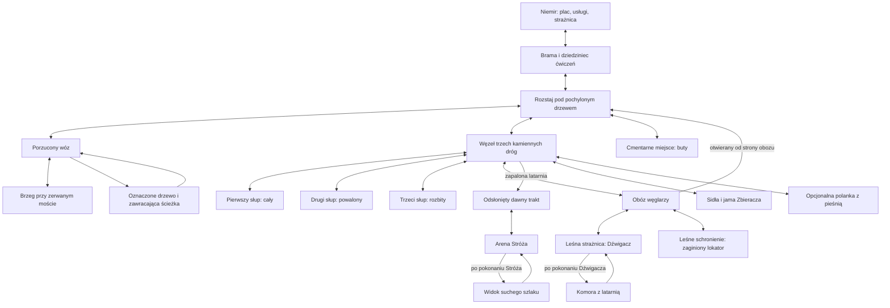

# Pakiet 04 — Niemir, las i przebieg demo

Status: propozycja przestrzeni do walidacji. Nie zatwierdza automatycznie pakietów 01–03 ani nowych faktów o świecie. Powstała według level-designer; obsada spotkań pochodzi z wcześniejszej pracy encounter-director.

Powiązania: [fabuła](demo-fabula.md), [spotkania](spotkania-i-bossowie.md), [początek i pierwsza wyprawa](pakiet-04-poczatek.md), [przegląd i walidacja](pakiet-04-przeglad.md).

## 1. Kształt całości

Niemir jest niewielką osadą wciśniętą między skałę ze źródłem a gęsty las. Jedna główna brama daje czytelny punkt powrotu. Po zewnętrznej stronie palisady biegnie krótka ścieżka gospodarcza; nie otwiera drugiego wyjścia z doliny. W obrębie palisady nie projektujemy walk ani obowiązkowego labiryntu wnętrz.

Las układa się w trzy powiązane obszary: **skraj z wozem**, **bór z kamieniami i odnogami**, **obóz i leśne ruiny**. To opis funkcjonalny, nie nowe nazwy własne. Zwykłe drogi dają się zapamiętać; nadprzyrodzone zawracanie występuje w konkretnych miejscach, nie losowo na każdym rozstaju.

Nie ma pól, rozległych miejskich placów, sieci podziemi pod każdym domem ani dalekich panoram świata. Gracz widzi tyle, ile może poznać podczas demo.

## 2. Schemat połączeń

Schemat jest topologiczny: pokazuje relacje, nie gotowy kształt terenu, skalę ani kierunki geograficzne.

Niemir jest punktem przygotowania, odpoczynku i rozliczenia. Drogę do finału otwiera latarnia zapalona w strażnicy osady, nie sam fakt podniesienia pustej lampy w ruinach. Powrót z latarnią korzysta ze skrótu przy obozie.

## 3. Obie strażnice

- **ZON-straznica-niemir:** budynek wewnątrz osady, wspólna latarnia, Wszebora, bezpieczeństwo. Kamienny fundament, lekka drewniana góra, mała sylwetka pionowa.
- **ZON-straznica-lesna:** zrujnowany obiekt przy dawnym trakcie; piec, Dźwigacz i komora przenośnej latarni. Ciężka, niska sylwetka przerwana zawalonym murem.
- Arena Stróża znajduje się dalej przy tym samym kompleksie dawnych ruin, ale dochodzi się do niej odsłoniętą drogą między słupami. Nie ma dostępnej wcześniej szczeliny z komory do końca demo.

To propozycja doprecyzowania topografii z pakietu 03. Nie ustanawiamy jeszcze wspólnego budowniczego ani daty powstania obiektów.

## 4. Niemir — usługi, ludzie i orientacja

| Strefa | Wejście i połączenia | Funkcja i prowadzenie wzroku | Proponowani mieszkańcy |
|---|---|---|---|
| Brama, ZON-brama | Rozstaj ↔ plac | Jedyny główny powrót; ciepłe światło ponad bramą, rzemienie pod dachem | Żegota; Nawoja przed wyprawami; Czcibor jako jeden z pierwszych informatorów |
| Dziedziniec, ZON-dziedziniec | Brama ↔ kuźnia | Ubita ziemia, trening bez ryzyka, wyraźnie otwarty środek | Żegota podczas ćwiczeń |
| Plac przy źródle, ZON-plac | Brama ↔ usługi ↔ strażnica | Skała i woda jako stały punkt orientacyjny; miejsce na wozy, nie monumentalny rynek | Domarad, Sambor, Milorad |
| Dom kupca ze składem, ZON-sklad [DECYZJA AUTORA, 28.10.2026] | Bezpośrednio przy placu | Największy dom w osadzie z przylegającym składem; pozostali kupcy rozkładają towar na placu | Kupiec, gospodarz składu |
| Dom gościnny, ZON-dom-goscinny | Bezpośrednio przy placu | Nocleg, zapis i powrót po wyprawie; ława dla gości przy wejściu | Miłka, Sulir |
| Kuźnia i chata zielarki, ZON-uslugi | Plac ↔ dziedziniec | Dwa odrębne domy po tej samej stronie placu; ogień i suszące się zioła | Radost, Dobrawa |
| Strażnica osady, ZON-straznica-niemir | Plac; dojście bez zagadki | Wspólna latarnia i krótka wizyta przy powrocie z ruin | Wszebora |
| Domy przy palisadzie, ZON-domy | Krótka pętla wracająca do placu | Prywatność, żałoba, ślady życia; bez przeszukiwania kilkunastu pustych wnętrz | Dzierżka, Mściwuj, Borzęta, Wojsława |

**Czcibor** [DECYZJA AUTORA, 28.10.2026] jest łowcą i jednym z pierwszych informatorów gracza, nie zaginionym lokatorem. Lokatorem z „Trzeciego przy stole” jest wędrowny cieśla Uniegost.

Nie wprowadzamy w demie swobodnego zabijania NPC: LPM na mieszkańcu inicjuje interakcję, nie wrogi cios. To propozycja zakresu i ochrony zadań, nie reguła świata, że mieszkańcy są nieśmiertelni. Nauka parady z Żegotą działa w osobnym, bezpiecznym ćwiczeniu.

Pierwszy nocleg jest miejscem przy wspólnym ogniu na kredyt za odzyskanie pakunków. Późniejsza nagroda za „Trzeciego przy stole” to prywatna izba, więc oba wydarzenia nie przyznają tego samego dostępu po raz drugi.

## 5. Karty obszarów lasu

Każdy obszar otrzymuje wymiary funkcjonalne, a nie niezweryfikowane metry. Zasady rozmiaru są w sekcji 8. Intensywność 1–5 jest roboczą oceną projektową, nie pomiarem trudności.

| ID / miejsce | Cel, wejście i wyjścia | Narzędzia przestrzenne i slot spotkania | Prowadzenie / intensywność |
|---|---|---|---|
| ZON-rozstaj | Brama, wóz, kamienie, cmentarne miejsce, późniejszy skrót z obozu | Szeroki węzeł bez stałego starcia; widoczne rozdzielenie kierunków | Pochylone drzewo, w tle światło bramy; 1 |
| ZON-woz | Rozstaj ↔ brzeg; pętla ścieżki wraca do wozu | Otwarty plac wokół wozu, dwie drogi obejścia, slot ENC-woz | Koń, koło i jasny pakunek widoczne przed wrogami; 2–3 |
| ZON-brzeg | Odnoga od wozu, powrót tą samą drogą | Złamany most, bez skoku nad wyrwą i bez wymaganej walki | Szum wody i widoczny drugi przyczółek; 1 |
| ZON-petla | Wóz → oznaczone drzewo → ten sam wóz | Krótka, rozpoznawalna pętla; bez losowego przestawiania mapy | Ten sam znak nacięcia i ten sam rekwizyt wozu; 2 |
| ZON-kamienie | Rozstaj ↔ trzy odnogi ze słupami ↔ obóz i odnogi poboczne | Każdy słup ma dojście z boku; slot ENC-kamienie nie blokuje wszystkich śladów | Odmienny stan każdego słupa; 2–3 |
| ZON-oboz | Kamienie ↔ ruiny; schronienie i otwierany skrót | Stos drewna dzielący linię ostrzału, oba boki drożne; ENC-oboz | Dym resztkowy, nie wesołe ognisko; 3 |
| ZON-straznica-lesna | Obóz ↔ arena Dźwigacza ↔ komora po zwycięstwie | Dwa obejścia filara; boss ma przejście po obu stronach | Piec i ruch nosidła; 4 |
| ZON-komora | Strażnica leśna; bez alternatywnego wyjścia za Stróża | Krótka, bezpieczna nagroda po walce | Zimna lampa, ciała zwrócone do zamurowanego przejścia; 1 |
| ZON-dawny-trakt | Węzeł kamieni ↔ arena Stróża, dostęp z zapaloną latarnią | Proste dojście na finał bez obowiązkowej powtórki wrogów | Słupy wyłaniające się ze światła; 2 |
| ZON-stroz | Dawny trakt ↔ suchy szlak po zwycięstwie | Arena opisana w pakiecie 03; brak ślepych wnęk i nieosiągalnych półek | Poprzecznie trzymane drzewce; 5 |
| ZON-suchy-szlak | Krótki odcinek za Stróżem; powrót do osady znaną drogą | Punkt potwierdzenia odkrycia, nie nowa mapa świata | Twarde podłoże i dalsza droga niknąca za drzewami; 1 |

Rozstaje mają rozpoznawalne sylwetki. Nie dekorujemy wszystkich identycznymi słupami, latarniami i zwłokami: wyjątkowe znaki muszą zachować znaczenie.

## 6. Odnogi poboczne

| Odnoga | Początek / powrót | Zawartość i nagroda | Niezależność |
|---|---|---|---|
| ZON-cmentarne-miejsce | Rozstaj ↔ miejsce przy leśnej skale | „Nie pal jego butów”; przedmiot i wiadomość, nie obowiązkowy miniboss | Żaden element nie otwiera głównej drogi |
| ZON-sidla i ZON-jama | Kamienie ↔ ślady sideł ↔ Zbieracz | „Puste sidła”; odzyskanie zapasów i rozliczenie z łowczynią Wojsławą [DECYZJA AUTORA, 28.10.2026] | Finał możliwy bez walki |
| Narzędzia przy obozie | Odgałęzienie na trasie przez obóz, powrót przy skrócie | „Żelazo pod korą”; narzędzia i usługa Radosta | Dźwigacz nie wymaga naprawy ani zakupu nowej broni |
| ZON-schronienie | Obóz ↔ mały szałas bez nowego lochu | „Trzeci przy stole”; odnalezienie Uniegosta, rozmowa i prywatna izba | Nie jest źródłem jedynej wskazówki o latarni |
| ZON-piesn | Kamienie ↔ niewielka polanka, powrót tą samą ścieżką | ENC-piesn, ślad i przygotowane drobne znalezisko | Bez nowego zadania wymaganego do ukończenia demo |

Odnaleziony Uniegost wraca do gospody po rozmowie po zakończeniu bezpośredniego zagrożenia; nie projektujemy dodatkowej eskorty z własną śmiercią NPC. Przedmioty znalezione wcześniej są rozpoznawane przy późniejszym przyjęciu zadania.

## 7. Droga główna i powroty

1. **Podejście:** prolog przy wozie → brama → nocleg.
2. **Pierwsza wyprawa:** poranna informacja o moście → bezpieczna próba sterowania → wóz → odzyskanie pakunków i obserwacja pętli → powrót.
3. **Badanie lasu:** trzy słupy w dowolnej kolejności → ślady rozbicia → rozmowa z Borzętą. Rozmowa daje kontekst, a nie niewidzialny zamek uniemożliwiający wcześniejsze odwiedzenie obozu.
4. **Dłuższa wyprawa:** obóz → Dźwigacz → komora z latarnią → skrót od strony obozu → Wszebora i zapalenie lampy w Niemirze.
5. **Finał:** kamienie → odsłonięty trakt → Stróż → potwierdzenie suchej drogi → powrót z wiadomością.

**Zasada powrotu [DECYZJA AUTORA, 28.10.2026]:** po przejściu lochu lub dłuższej odnogi gracz nie wraca tą samą, już pustą drogą. Otwiera się krótsze, alternatywne przejście do początku wyprawy (bliżej osady lub rozstaju), przy którym może leżeć drobna nagroda. Wzorem jest Skyrim; skrót od strony obozu jest pierwszym przykładem.

Przejścia wymagane: pokonany Dźwigacz otwiera komorę; latarnia zapalona w osadzie odsłania trakt; pokonany Stróż otwiera suchą drogę. Żaden z tych warunków nie zależy od losowego łupu, pobocznego bossa, zużywalnej pochodni ani poziomu umiejętności.

Pętla lasu działa tylko na wyraźnie wskazanym dawnym wyjściu. Nie przenosi bohatera podczas walki, nie resetuje zapasów ani wrogów, nie odbiera kursora i nie usuwa znaku na drzewie. Odkryta ścieżka powrotna do osady pozostaje stabilna.

## 8. Metryki do projektu z prostych brył

Najpierw należy zmierzyć w prototypie: D — średnicę kolizji bohatera, B — największy obrys lokalnego przeciwnika, U — pełny dystans uniku, A — zasięg jego groźnego ataku, V — widoczny obszar podłoża w kamerze. Nie ustalamy metrów przed tym pomiarem.

- Zwykłe drzwi: przejście większe niż D z marginesem dla sterowania kliknięciem; brak zaczepiania o dekoracje.
- Przejścia używane do omijania bossa: większe niż B z marginesem na obrót i nawigację, po obu stronach przeszkody.
- Pole nauki uniku: pełny tor U plus bezpieczny obszar startu i zakończenia; żadnego drzewa kończącego pierwszy odskok.
- Arena: umożliwia wyjście poza A pełnym lub częściowym U; nie wymaga podwójnego uniku jako jedynej odpowiedzi. Jeśli zmienimy U, wracamy do testu areny.
- Wóz i stos drewna: faktyczna kolizja zatrzymuje również pociski; droga obejścia jest dostępna dla odpowiedniego przeciwnika.
- Walka musi mieścić czytelną zapowiedź w V. Kamera i odsłanianie koron drzew są częścią projektu, nie kosmetyką.
- Głębokie urwiska są granicą terenu. Nie dodajemy skoku, wspinania ani obrażeń od upadku do wymagań pierwszej wyprawy.

Warunki odbioru mają wykazać brak klinowania ruchu, dostępność obu obejść i widoczność zapowiedzi. Same założenia nie dowiodą tych warunków.

## 9. Zakres pierwszego grywalnego fragmentu

**Brama i mały fragment osady → rozstaj → plac przy wozie → powrót do Żegoty.** Potrzebne są: jedno miejsce ćwiczeń, Pies, Powrotnik jako drugi krok, przedmiot zadania, rozmowa rozliczenia, zapis i ponowne wczytanie. Zależności oraz kolejność budowy opisuje [początek gry](pakiet-04-poczatek.md).

Pełna osada, wszystkie sklepy, trzy słupy, Dźwigacz i Stróż nie są warunkiem pierwszego testu pętli. Ich miejsca pozostają zaprojektowane, ale nie muszą zostać zbudowane naraz.

Grafy: [układ demo](graphs/layout-demo.json), [pierwsza wyprawa](graphs/layout-first-expedition.json). Ich bramki są symbolicznymi stanami zadania i świata; graf nie modeluje skali, kolizji ani czasu.
