# Przeciwnicy — bestiariusz, spotkania i bossowie (pakiet 03)

Status: propozycja (pakiet 03). HP, obrażenia, prędkości i odporności powstaną w etapie balansu.
Powiązania: [walka](walka.md), [mechaniki](mechaniki.md), [mapa demo](mapa-demo.md).

## Część I — bestiariusz

### Zasady projektowe

Proponowana obsada: siedem typów zwykłych przeciwników (karta wilka do opracowania), dwóch minibossów i finałowy Stróż. Minibossowie korzystają z rodzin zachowań zwykłych przeciwników; nie wymagają trzech odrębnych systemów walki z bossami.

Groza wynika z życia, które nadal próbuje się powtarzać. Przeciwnik może strzec pustego domu, nieść niepotrzebny już zapas albo wołać kogoś, kto nie odpowie. Nie każdy jest świadomy i nie każdy rozumie, co robi. To wskazówki wykonawcze, nie ujawniona prawda o kosmologii Weleszy.

Przeciwnicy w borze to demony i duchy lasu albo zwierzęta, nie żywi ludzie [DECYZJA AUTORA, 28.10.2026]. Ludzką sylwetkę mają tylko istoty, które las przejął lub odmienił (Drwal, Łucznik, Powrotnik, Dźwigacz). Wyjątkiem jest Zdziczały pies, zwykłe zwierzę bliżej wioski.

Koncepty wyznaczają kierunek wyglądu, nie wzrost ani wymiary [DECYZJA AUTORA, 28.10.2026]. Skalę ustalamy w kamerze gry; wzrost bohatera się nie zmienia.

Przeciwników będzie wielu, dlatego każdy typ ma warianty wyglądu i uzbrojenia, żeby nie był to atak klonów [DECYZJA AUTORA, 28.10.2026]. Warianty jednego typu dzielą tryby ataku, np. hak i sierp na trzonku. Limit aktywnych wrogów w jednym starciu z projektu spotkań nadal obowiązuje.

Nie używamy dzieci jako przeciwników, przypadkowej makabry jako głównego środka ani żartobliwych odzywek przy śmierci. Ciała i rekwizyty mogą być niepokojące bez eksponowania okaleczeń.

Każdy groźny ruch ma sygnał wizualny i dźwiękowy; odróżnienie ataku nieparowalnego nie zależy wyłącznie od koloru. Przeciwnicy nie wykonują nieczytelnych ataków spoza ekranu. Roślinność musi odsłaniać sylwetkę podczas zapowiedzi ataku.

Nowe ofiary i istoty nie dopisują historii do zatwierdzonych NPC. Ślady człowieczeństwa są obserwacjami; ich interpretacja może pozostać niepewna. Żadna karta nie rozstrzyga źródła zamknięcia boru.

### Zwykli przeciwnicy

#### ENM-zdziczaly-pies — Zdziczały pies

**Rola:** flankujący napastnik; porzucone zwierzę. **Pytanie:** czy potrafisz zejść z linii skoku, nie oddając drugiemu napastnikowi pleców?

**Sylwetka:** niski, wychudzony korpus; zerwany rzemień obroży; jasna łatka widoczna w ciemnym futrze. Dźwięk: warkot przechodzi w ciche skomlenie, kiedy traci cel. Nie jest to magiczny wilk.

**Koncept sceny:** [pies, Powrotnik i Drwal na mokrym trakcie](art/bestiariusz/sceny/powrotnik_pies_drwal.png). Pies ma niską, napiętą sylwetkę i zmoczone, ciemne futro; scena służy porównaniu skali przeciwników.

**Zachowanie:** czujny, głodny, nerwowy. Chce bronić znalezionego pożywienia, boi się osaczenia. Przeczucie dawnego przywiązania: po walce siada czasem przy porzuconym wozie zamiast szukać kolejnej ofiary.

**Priorytety AI:** pilnuje miejsca → ostrzega → obiega cel po dostępnej stronie → atakuje po odsłonięciu → po chybieniu odzyskuje równowagę → ściga do czytelnej granicy. Samotny pies nie ma obowiązku rzucać się pod ostrze bez przerwy.

| Atak | Zapowiedź | Efekt | Odpowiedź i okazja |
|---|---|---|---|
| Skok do gardła | Przysiad, uszy do tyłu, krótki warkot | Skok po ustalonym torze; bez śledzenia gracza w locie | Unik w bok lub wyjście z toru; po chybieniu możliwość ciosu |
| Kłapnięcie | Odsunięcie łba i odsłonięcie kłów | Krótki atak blisko celu | Odstąpienie zamiast długiego łańcucha |

**Obrona:** ataków zwierzęcia nie parujemy. **Słabość:** długi skok oddaje inicjatywę, jeśli spudłuje. **Łup:** nie generuje monet; obroża może być rekwizytem bez wartości handlowej. **Występowanie:** bliżej wioski [DECYZJA AUTORA, 28.10.2026]: wóz, rozstaj, skraj traktu.

#### ENM-wilk — Wilk

**[DECYZJA AUTORA, 28.10.2026]** Osobny potwór, odrębny od Zdziczałego psa. Duży i szary, wyraźnie większy od burego psa ([kierunek artystyczny](art/WELESZA_DARK_PAINTERLY_2D_KIERUNEK_ARTYSTYCZNY_v1.pdf), s. 9).

**Rola:** samotny myśliwy głębszego lasu; rodzina zachowań psa (skok do gardła, kłapnięcie, obieganie celu), ale trudniejszy. **Różnice:** więcej zdrowia i mocniejsze ugryzienie, krótsza okazja po chybionym skoku; potrafi wyskoczyć z boru na idącego ścieżką gracza; zapowiedź pozostaje równie czytelna. Wartości w etapie balansu.

**Występowanie:** las: kamienie, obóz, dalsze odnogi. Pojedynczo, najwyżej w parze, zgodnie z limitem aktywnych wrogów.

#### ENM-powrotnik — Powrotnik

**Rola:** powolny napastnik; dawna ofiara traktu. **Pytanie:** czy zauważysz różnicę między niegroźnym powłóczeniem nogami a przygotowaniem chwytu?

**Sylwetka:** pochylony człowiek z ciężkim plecakiem [DECYZJA AUTORA, 28.10.2026]; ręka stale zaciśnięta na pasie plecaka; wyblakły pas tkaniny przy nadgarstku. Dźwięk: oddech i tarcie mokrej tkaniny. Nie wypowiada wyjaśniających zdań.

**Koncepty:** [widoki postaci](art/bestiariusz/powrotnik/01_widoki_postaci.png), [spotkanie na trakcie](art/bestiariusz/powrotnik/02_spotkanie_na_trakcie.png), [scena wspólna z psem i Drwalem](art/bestiariusz/sceny/powrotnik_pies_drwal.png). Na planszach Powrotnik jest pochylony pod ciężarem bagażu, w warstwowym, znoszonym ubraniu. Koncepty są wzorcem wyglądu.

**Zachowanie:** uparty, zagubiony, przywiązany do drogi. Próbuje ruszyć dalej, lecz wraca do tego samego kamienia. Nie ma nowej frakcji ani potwierdzonego związku z duszą pierwotnej osoby.

**Priorytety AI:** powtarza krótki obchód → reaguje na wejście blisko → podchodzi bez sprintu → z dystansu rzuca czymś z plecaka → chwyta tylko z odpowiedniego zasięgu → po utracie celu wraca na obchód.

| Atak | Zapowiedź | Efekt | Odpowiedź i okazja |
|---|---|---|---|
| Oburęczny chwyt | Prostuje się pod plecakiem, wyciąga ramiona, nabiera powietrza | Krótki frontalny atak; bez QTE i długiej animacji więzienia gracza | Unik na bok, atak z flanki po chybieniu |
| Rzut z plecaka [DECYZJA AUTORA, 28.10.2026] | Sięga przez ramię do plecaka, słychać przedmioty w środku | Rzut przedmiotem po stałym torze, bez naprowadzania; krótki zasięg | Zejść z toru; skrócić dystans, gdy znów szuka w plecaku |

**Obrona:** chwyt jest nieparowalny; rzucony przedmiot zatrzymuje garda, parada go nie odbija. Sam gatunek „nieumarły” nie gwarantuje parowania — istotny jest atak bronią. **Słabość:** wolne odzyskiwanie pozycji. **Łup:** czasem konkretny przedmiot z historii miejsca, bez losowego skarbu. **Występowanie:** przy wozie, drogowskazach i kamieniach.

#### ENM-drwal — Drwal z wygasłego obozu

**Rola:** uzbrojony przeciwnik uczący gardy. **Pytanie:** kiedy parować narzędzie, a kiedy zejść z drogi ciężkiemu zamachowi?

**Kim jest [DECYZJA AUTORA, 28.10.2026]:** ożywieniec związany z lasem — dawny drwal, którego ciało i duszę przejęły korzenie i gniew zapomnienia. Siła, brutalność, powolna nieustępliwość: porusza się ciężko, ale uderza z ogromną mocą.

**Sylwetka:** ludzka, szeroka postać w kapturze; rozkładające się ciało zrośnięte z korzeniami, z głowy i barków wyrastają gałęzie; skórzane pasy na poszarpanych łachmanach; długi topór. Od Korzeńca odróżnia go ludzka postawa i topór. Dźwięk: przed atakiem przesuwa dłoń po trzonku; poza walką układa drwa.

**Warianty wyglądu** (wspólne tryby ataku): podstawowy, rozkład (widoczne kości), leśny (silniej zrośnięty z drewnem), zimowy (szron i lód), strażnik traktu (najstarszy, pień zamiast ramienia), okrwawiony (świeże ofiary, ludzkie trofea; rzadki wariant, może nie trafić do gry [DECYZJA AUTORA, 28.10.2026]). **Broń:** topór drwala, topór rozwidlony, ciopak, zreb związany z korzeniami, obosieczny.

**Zachowanie:** pracowity, drażliwy, wyczerpany. Broni pustego paleniska, choć drewno leży w wodzie. Chce przepędzić obcego; nie prowadzi zrozumiałej rozmowy. Pozostaje tragiczną istotą Weleszy: gniew i zapomnienie są wyczuwalne, zanim zaatakuje.

**Koncepty:** [portret i detale](art/bestiariusz/drwal/01_drwal_portret_i_detale.png), [sylwetki, warianty, broń i pozy](art/bestiariusz/drwal/02_drwal_arkusz_koncepcyjny.png), [scena wspólna z Powrotnikiem i psem](art/bestiariusz/sceny/powrotnik_pies_drwal.png). Koncept jest wzorcem wyglądu.

**Priorytety AI:** nie atakuje z zaskoczenia → ostrzega ruchem topora → broni wejścia → zwykły zamach w zasięgu → przy uporczywej gardzie gracza wybiera wyraźnie zapowiedziany ciężki atak → po chybieniu wraca do gotowości → atak obrotowy tylko wobec gracza krążącego blisko. Reakcja nie jest odczytem przycisku gracza w tej samej klatce.

| Atak | Zapowiedź | Efekt | Odpowiedź i okazja |
|---|---|---|---|
| Cięcie z boku | Obrót barków i szurnięcie trzonka | Parowalny zamach toporem | Garda lub precyzyjna parada; odsłonięta strona po zamachu |
| Rozłupanie | Obie dłonie nad głową, krótki bezruch, głośny wysiłek | Nieparowalne pionowe uderzenie | Zejść w bok; ostrze na chwilę grzęźnie w podłożu |
| Atak obrotowy [DECYZJA AUTORA, 28.10.2026] | Topór nisko za plecami, skręt tułowia, przeciągły jęk drewna | Pełny obrót wokół siebie, parowalny; rzadki, nie dwa razy z rzędu | Odejść poza zasięg topora albo sparować; po obrocie chwiejny i odsłonięty |

**Słabość:** silny, ale po ciężkim ataku nie odwraca się natychmiast. **Łup:** przygotowany materiał lub narzędzie związane z obozem; zwykła broń nie musi być ulepszeniem. **Występowanie:** obóz węglarzy i zadanie o narzędziach.

#### ENM-lucznik — Łucznik pustego traktu

**Rola:** napastnik dystansowy. **Pytanie:** jak skrócić dystans, korzystając z osłon i przerw między strzałami?

**Kim jest [DECYZJA AUTORA, 28.10.2026]:** porzucony strażnik traktu, odmieniony przez las w szaleńca. Obdarty, pokryty ranami i bliznami, żyje już tylko siłą nienawiści lasu do intruzów.

**Sylwetka:** wychudzony, obdarty, z dzikimi włosami i brodą; łuk, kołczan ze strzałami o czerwonych lotkach, nóż; mały wisior na piersi jako ślad dawnej służby. Twarz wykrzywiona w krzyku. Dźwięk: tarcie cięciwy, urywany krzyk albo sygnał, na który nikt nie odpowiada.

**Koncept:** [plansza łucznika, warianty i sceny](art/bestiariusz/lucznik-pustego-traktu/01_karta_koncepcyjna.png). Koncept jest wzorcem wyglądu; warianty dzielą tryby ataku.

**Zachowanie:** szaleńczy w gestach i głosie, ale w strzale nadal strażnik: odruchy dawnej służby zostały. Krąży przy trakcie, jakby wciąż pilnował odprawy kupieckiej, której już nie ma. Nie ucieka w nieskończoność.

**Priorytety AI:** obserwuje drogę → ustawia linię strzału → naciąga widocznie → strzela w zablokowany przed wypuszczeniem kierunek → zmienia pozycję do wcześniej dostępnego punktu. W zwarciu odsuwa się, a jeśli nie ma miejsca, używa noża. Nie strzela przez osłony ani ściany.

| Atak | Zapowiedź | Efekt | Odpowiedź i okazja |
|---|---|---|---|
| Strzał | Wyprost, pełne naciągnięcie, skrzypienie cięciwy | Widoczny pocisk bez naprowadzania | Osłona lub ruch w poprzek; podejście między strzałami |
| Cięcie nożem | Odkłada łuk na bok i odsłania rękę z nożem | Parowalny, krótki cios | Garda/parada, nie zakładać bezbronności strzelca |

**Słabość:** ograniczone punkty odwrotu i przygotowanie strzału. **Łup:** niewielki, określony zapas amunicji przy stanowisku; jednorazowy. **Występowanie:** podejście do leśnej strażnicy, bez strzelania z nieosiągalnych balkonów.

#### ENM-zalobnica — Żałobnica

**Rola:** wsparcie blokujące łatwą okazję; ślad żałoby. **Pytanie:** czy najpierw przerwiesz śpiew, czy odciągniesz chronionego przeciwnika?

**Kim jest [DECYZJA AUTORA, 28.10.2026]:** demon lasu.

**Sylwetka:** wysoka, wąska postać w warstwach ciemnych, poszarpanych tkanin; welon i wianek z gałązek; pod welonem twarz bez twarzy; długie, jasne dłonie; talizmany żałoby (medalion, dzwonek). Dźwięk: melodia bez słów, kończąca się za każdym razem przed ostatnią nutą.

**Koncept:** [plansza Żałobnicy](art/bestiariusz/zalobnica/01_karta_koncepcyjna.png). Koncept jest wzorcem wyglądu.

**Zachowanie:** cierpliwa, troskliwa, zaborcza. Zachowuje się, jakby próbowała kogoś ochronić.

**Priorytety AI:** pozostaje przy chronionym miejscu → rozpoczyna śpiew tylko przy widocznym sojuszniku → podtrzymuje osłonę jednego celu → przerywa po otrzymaniu trafienia lub utracie zasięgu/łączności wzrokowej → szuka nowej pozycji. Nie leczy HP i nie wskrzesza wrogów.

| Zdolność | Zapowiedź | Efekt | Odpowiedź i okazja |
|---|---|---|---|
| Niedokończona pieśń | Podnosi welon i odsłania twarz bez twarzy; początek melodii, widoczne połączenie z celem | Jednorazowa redukcja następnego trafienia w chronionego wroga; nigdy pełna odporność; nie kumuluje się | Trafić śpiewającą, przerwać widoczność albo wyczerpać osłonę zwykłym ciosem |
| Odepchnięcie | Zbiera tkaniny przy piersi, gwałtowny wdech | Bliski, nieparowalny atak odpychający, bez dalszego przyciągania | Odskok, po ataku przerwa w śpiewie |

**Słabość:** nieruchoma podczas pieśni, osłona nie obejmuje jej samej. **Łup:** brak automatycznej kosztowności; po walce zostaje welon jako ślad. **Występowanie:** późny fragment lasu; nowy efekt osłony wymaga implementacji i jest kandydatem do odłożenia przy ograniczeniu zakresu.

#### ENM-korzeniec — Korzeniec

**Rola:** terytorialny brutal; przyroda zawłaszczająca ludzkie ślady. **Pytanie:** czy odróżnisz bezpieczny bok od dalekiego zasięgu przednich kończyn?

**Sylwetka:** niski, szeroki kadłub; długie przednie korzenie jak ramiona; skrawek lnianej tkaniny tkwiący w korze. Dźwięk: napinanie mokrego drewna, bez demonicznego śmiechu.

**Zachowanie:** nieruchomy, cierpliwy, gwałtowny po naruszeniu terenu. Otacza korzeniami porzucone przedmioty. Interpretacja, że kiedyś coś lub kogoś chronił, pozostaje domysłem.

**Priorytety AI:** przed wykryciem wyraźnie porusza się i oddycha, nie zadaje kontaktowych obrażeń z ukrycia → obraca się ku intruzowi → sięga daleko → po chybieniu powoli składa kończyny → po obejściu używa czytelnego ataku bocznego.

| Atak | Zapowiedź | Efekt | Odpowiedź i okazja |
|---|---|---|---|
| Zagarnięcie | Wysuwa korzenie po ziemi i napina je, słychać trzask | Długi atak stożkowy, nieparowalny | Unik poprzeczny; podejście do odsłoniętego boku |
| Przetoczenie | Wyraźnie przenosi ciężar na przeciwny bok | Krótki boczny atak przeciw ciągłemu obchodzeniu | Odejść od kadłuba, wrócić po ruchu |

**Słabość:** obrót i odzyskanie pozycji, brak nagłego teleportu do celu. **Łup:** zapasy lub rekwizyt znajdują się w otoczeniu, nie w losowej tabeli z ciała. **Występowanie:** korzenie przy kamieniach i odnoga z sidłami.

### Minibossowie i boss

#### ENM-zbieracz — Zbieracz spod korzeni, opcjonalny miniboss

**Rodzina:** Korzeniec; większe przednie kończyny i asymetrycznie obrośnięty bark. **Rola:** kontrola kierunku podejścia; niejednoznaczny opiekun. Związany z „Pustymi sidłami”.

W jamie wiszą porozrywane sidła, a pod nimi leżą starannie ułożone zęby. Nie pokazujemy ludzkich ofiar ani nie wyjaśniamy pochodzenia zębów. Zbieracz osłania puste legowisko jak coś, co wciąż warto chronić.

**Osobowość w ruchu:** czujny, metodyczny, ochronny; niszczy pułapki, a równocześnie atakuje intruza. Chce odsunąć gracza od legowiska, nie ściga go do osady.

**Zdolności:** zagarnięcie i przetoczenie Korzeńca oraz szeroki zamach oboma ramionami, poprzedzony pełnym wyprostem i trzaskiem korzeni. Wszystkie nieparowalne. Szeroki zamach kończy się odsłonięciem boku; szczegóły faz w projekcie walki.

**Smutny akcent:** po zwycięstwie kamera nie pokazuje trofeum, tylko puste miejsce pod osłaniającymi je ramionami. Interpretacja należy do gracza. **Nagroda:** odzyskane zapasy i rozliczenie zadania, bez konieczności łupienia ciała.

#### ENM-dzwigacz — Dźwigacz, miniboss przy strażnicy

**Rodzina:** zachowania Drwala; szeroka, ludzka sylwetka z nosidłem pełnym mokrego drewna. **Broń [DECYZJA AUTORA, 28.10.2026]:** hak lub sierp na trzonku, nie topór; oba warianty mają te same tryby ataku. **Rola:** test rozróżnienia parady i uniku; pracownik powtarzający obowiązek.

Wciąż nosi drewno do dawno zgasłego pieca. Nie wyjaśniamy, czy kieruje nim pamięć, rozkaz czy sama powtarzalność. Jest wyczerpany, uporczywy i pilnujący narzędzi; boi się pozostawić piec pusty. Przed walką stawia nosidło delikatniej, niż traktuje własne ciało.

**Zdolności:** parowalne cięcie hakiem lub sierpem, nieparowalne rozłupanie oraz nieparowalne pchnięcie nosidłem z widocznym wyprostowaniem pleców. Po utracie części zdrowia porzuca nosidło: znika pchnięcie, pojawia się drugi, wyraźnie zapowiedziany zamach hakiem lub sierpem.

**Słabość:** po ciężkim zamachu zostaje długa okazja; precyzyjna parada zwykłego cięcia daje krótszą. **Głos:** wydechy i krótkie pomruki, nie monolog wyjaśniający świat. **Nagroda:** bezpieczny dostęp do komory z latarnią; brak obowiązkowej amunicji, ognia lub specjalnej broni do zwycięstwa.

#### ENM-stroz — Stróż, boss finałowy

**Rola:** finałowy test kontroli zachłanności; strażnik o nieznanym celu. **Sylwetka:** bardzo wysoka postać, wyraźnie górująca nad bohaterem, w zardzewiałej zbroi i kolczudze pod postrzępionymi warstwami tkanin; kaptur, a pod nim zamiast twarzy czarna mgła; blade, ludzkie dłonie; długa pika z szerokim grotem; przywiązane do pasa i pleców bagaże podróżnych (zwinięte posłanie, sakwy, pusta klatka na ptaka); zwykła latarnia [DECYZJA AUTORA, 28.10.2026]. Nie jest to magiczna latarnia z komory. Część przedmiotów przypomina wcześniejsze znaleziska, ale nie potwierdza to ich pochodzenia.

**Koncept:** [plansza Stróża](art/bestiariusz/stroz/01_karta_koncepcyjna.png): widoki, detale, cztery warianty i widok w grze. Koncept jest wzorcem wyglądu. Obraz nie rozstrzyga pochodzenia Stróża.

**Zachowanie:** cierpliwy, nieustępliwy, niemal ceremonialny. Staje między graczem a wyjściem; nie rabuje i nie świętuje zwycięstwa. Głosy są ciche, różne, czasem sprzeczne. Nie naśladuje bliskich bohatera ani nie dopisuje mu osobistej przeszłości.

**Chce:** zatrzymać przejście. **Boi się:** nieujawnione; nie ustanawiamy nowego kanonu. **Sprzeczność:** brutalnie atakuje, ale po utracie celu podnosi upuszczony pakunek, zanim wróci do posterunku.

**Zdolności:** parowalne cięcie drzewcem, nieparowalne pionowe uderzenie, oznaczony szarżujący pochód oraz oślepienie latarnią [DECYZJA AUTORA, 28.10.2026]: świeci zwykłą latarnią w oczy bohatera. Latarnia jest też rekwizytem i źródłem światła areny. Kolejne fazy zmieniają sposób zakończenia kombinacji, nie dodają tłumu przywołań. Szczegółowy przebieg w projekcie walki.

**Smutny akcent:** przy śmierci pakunki spadają na ziemię, a urwany głos kończy zwyczajne „już idę”. Nie wyjaśniamy, kto mówił. Muzyka milknie; słychać tylko las. **Nagroda:** otwarte przejście i spełniony cel demo, bez fontanny złota.

### Zależności i priorytet wykonania

Najpierw Pies i Drwal: sprawdzają unik, paradę oraz przerwanie wiązanki. Potem Powrotnik i Łucznik, następnie Korzeniec i jego miniboss. Żałobnica wymaga dodatkowego efektu osłony, więc ma najniższy priorytet w pierwszym prototypie. Dźwigacz i Stróż wymagają reżyserii faz oraz testów areny.

Przy ograniczaniu zakresu najpierw odkładamy Żałobnicę i opcjonalnego Zbieracza, zachowując ich projekty. Nie usuwamy automatycznie zaakceptowanych zadań; ewentualne cięcie treści wymaga walidacji autora.

Każda broń i sylwetka potrzebują osobnego sprawdzenia czytelności w docelowej kamerze. Nie podajemy wyceny produkcji bez ustalenia zespołu i testu produkcji grafiki 2D w Godocie.

## Część II — spotkania i boss fighty

Metoda: encounter-director.

### 1. Wspólne reguły spotkań

Proponujemy ręcznie rozmieszczone spotkania dla demo. Zwykłe starcia mają najwyżej dwóch aktywnych przeciwników. Trzeci może występować tylko w wyraźnie oznaczonej, opcjonalnej grupie; nie jest wymagany w projektach poniżej. Bossowie są świadomymi pojedynkami bez dodatkowych fal — wyjątek od zalecenia mieszania ról wynika z celu samotnej, precyzyjnej walki.

Limit aktywnych wrogów obejmuje sąsiednie grupy w tym samym obszarze walki. Nie wystarczy ograniczyć osobno dwóch paczek, które mogą jednocześnie ścigać gracza. Granice patrolu, odległość i punkty odwrotu należy zweryfikować w mapie.

Starcie nie musi zaczynać się od podejścia gracza do przeciwnika [DECYZJA AUTORA, 28.10.2026]. Zwierzęta mogą zaatakować z zaskoczenia, np. wilk wyskakuje z boru przy ścieżce; ludzie i ich szczątki (Drwal, Łucznik, Powrotnik) nie. Zakaz ataków z ukrycia chronił przed tym, by o wyniku decydował los, więc zasadzka wynika z miejsca i natury zwierzęcia, nie z losowania, i ma krótką, czytelną zapowiedź w kadrze (szelest, ruch w zaroślach). Gracz zmęczony sprintem wchodzi wtedy do walki z niższą wytrzymałością. Nie ma pojawiania się znikąd za plecami, odnawiania wrogów podczas odpoczynku ani ataków spoza widocznego obszaru. Po wykryciu gracza wrogowie muszą pokazać wejście w stan walki. Ostrzał wymaga linii widzenia i czytelnej zapowiedzi. Odwrót wroga po utracie ścieżki nie upoważnia go do przenikania przez geometrię.

Zapowiedź może podążać za graczem tylko do określonego momentu; właściwy zamach lub skok ma ustalony tor. Obrót w ostatniej chwili nie może unieważniać poprawnego uniku. Okna czasowe to parametry do testów, nie liczby zadeklarowane na papierze.

#### Oczekiwana gotowość gracza

| Etap | Wymagane możliwości | Niewymagane |
|---|---|---|
| Wóz i pierwszy las | Podstawowa broń wręcz, ruch, unik | Garda, PPM, łuk, szkolenie |
| Obóz i kamienie | Znajomość uniku; możliwość gardy/parady przy broni wręcz | Zakup PPM lub wyższego stopnia wiązanki |
| Zbieracz | Podstawowy atak i unik, wiedza o Korzeńcu | Specjalny żywioł, pułapki, przedmiot zadaniowy do zadawania obrażeń |
| Dźwigacz | Rozpoznanie zwykłego i ciężkiego zamachu; unik | Udana precyzyjna parada, konkretna broń dystansowa |
| Stróż | Rozpoznanie typów ataku, przerwanie własnej wiązanki | III stopień kombinacji, krytyk, PPM, magia |

Poziomy, HP, obrażenia, TTK i docelowe czasy pojedynków pozostają do pomiarów oraz balansu. Projekt zakłada możliwość wygrania samym podstawowym wyposażeniem.

### 2. Spotkania zwykłe i nauczanie

#### ENC-woz — Porzucony wóz

**Miejsce:** zatwierdzony wóz przy trakcie. **Zadanie:** „Miejsce przy ogniu”. **Cel:** odzyskać pakunki i nauczyć się uniku.

Pies jest widoczny przy rozrzuconym jedzeniu. Powrotnik stoi dalej przy drodze. Najpierw celowo odizolowane starcie z Psem; drugie starcie może połączyć poznanego Psa z Powrotnikiem. Nie aktywują się automatycznie przez podniesienie łupu.

**Rozwiązania:** zejście z toru skoku i kontratak albo utrzymanie dystansu z użyciem wozu do rozdzielenia podejść. Wóz ogranicza drogę obu stronom; nie tworzy miejsca, z którego można bezkarnie trafiać przez skrzynię.

**Koniec:** pakunki i księga są dostępne również po wcześniejszym pokonaniu wrogów. **Porażka:** wczytanie bezpiecznego zapisu. **Cisza:** koń nie musi umierać; po starciu wraca dźwięk jego oddechu.

#### ENC-oboz — Zimne palenisko

**Miejsce:** istniejący obóz węglarzy. **Powiązanie:** „Żelazo pod korą” i trasa do strażnicy. **Cel:** rozpoznać cios parowalny i ciężki.

Najpierw widoczny Drwal samotnie pracuje. Po poznaniu wzorców kolejny fragment wykorzystuje Drwala i Łucznika, z których drugi ma przerywaną linię ostrzału przez stos drewna. Nie ma nieskończonych posiłków.

**Rozwiązania:** sprowokować Drwala do odejścia od strzelca i pokonać po kolei albo wykorzystać osłonę i najpierw skrócić dystans do Łucznika. PPM rozbijające gardę nie jest wymagane.

**Nagroda:** narzędzia i otwarty skrót. **Cisza:** przy palenisku stoi miska przykryta deską przed deszczem; nikt już po nią nie przychodzi.

#### ENC-kamienie — Ścieżka, która zawraca

**Miejsce:** okolica kamieni z zadania „Droga, która wraca”. **Skład:** Korzeniec, następnie w osobnej części Powrotnik. **Cel:** nauczyć się szerokiego zagrożenia przy gruncie bez ataków z ukrycia.

Korzenie poruszają się przed wejściem gracza w ich zasięg. Kamień zadaniowy nie blokuje uniku ani nie wymaga pokonania potwora w konkretnym miejscu.

**Rozwiązania:** walka na boku po zagarnięciu albo obejście Korzeńca i zbadanie słupa z innego kierunku. Nie każdy potwór jest obowiązkowym zamkiem do zadania.

**Koniec:** zbadanie właściwego śladu, niezależnie od kolejności odwiedzenia kamieni. **Cisza:** ślady stóp wracają do tego samego miejsca; bez narratora wyjaśniającego las.

#### ENC-piesn — Pieśń bez ostatniej nuty

**Miejsce:** późna odnoga istniejącego lasu. **Skład:** Żałobnica i Powrotnik. **Cel:** rozwiązać osłonę bez uzależnienia od konkretnej broni.

Powrotnik stoi w przejściu, a Żałobnica pozostaje widoczna za nim. Pieśń i połączenie pokazują, kto daje osłonę. Zanim pojawi się para, gracz może obserwować samotną Żałobnicę z bezpiecznej odległości.

**Rozwiązania:** trafić Żałobnicę i przerwać podtrzymywanie albo odciągnąć Powrotnika za istniejącą przeszkodę, zrywając połączenie. Trzecia, mniej wydajna możliwość: zużyć jednorazową osłonę zwykłym ciosem.

**Koniec:** dostęp do niewielkiego znaleziska, bez wymaganej fabularnej nagrody. **Uwaga zakresowa:** osłona to nowa zdolność do osobnego wdrożenia; spotkanie nie blokuje głównej drogi.

### 3. Wspólna maszyna stanów bossów

```mermaid
stateDiagram-v2
    [*] --> Dostepny
    Dostepny --> Zapowiedz: wejście gracza w oznaczony obszar
    Zapowiedz --> Faza1: koniec czytelnej zapowiedzi
    Faza1 --> Przejscie: zdrowie spełnia warunek następnej fazy
    Przejscie --> FazaN: zakończenie przerwy
    FazaN --> Przejscie: istnieje dalsza faza i spełniony warunek
    Faza1 --> Zwyciestwo: zdrowie bossa spada do zera
    FazaN --> Zwyciestwo: zdrowie bossa spada do zera
    Faza1 --> Reset: gracz wychodzi poza obszar
    FazaN --> Reset: gracz wychodzi poza obszar
    Przejscie --> Reset: gracz wychodzi poza obszar
    Zapowiedz --> Reset: gracz wychodzi poza obszar
    Reset --> Dostepny: boss wraca; pełne zdrowie i faza początkowa
    Zwyciestwo --> Rozliczony: jednorazowa nagroda i stan zadania zapisane razem
    Rozliczony --> [*]
```



Śmierć gracza jest obsługiwana przez przywrócenie spójnego zapisu, a nie reset jednego elementu walki. Wznowienie sesji odtwarza aktualny stan. Zwycięstwo ma pierwszeństwo nad zmianą fazy, gdy zdrowie bossa spadnie do zera i gracz przeżyje bieżący krok walki. Przy jednoczesnej śmierci gracza i bossa przywracamy zapis sprzed próby, bez zachowania nagrody.

Zmiany faz są monotoniczne do końca próby. Parametry progów zdrowia ustalimy podczas balansu. Po przekroczeniu progu boss kończy bieżący atak, usuwa oczekujące ataki i dopiero wtedy wykonuje widoczną zmianę zachowania. Jeśli pojedynczy cios przekroczy więcej progów, wybieramy najwyższą należną fazę po jednej przerwie, bez nakładania animacji i ataków.

Podczas krótkiej, wyraźnej animacji przejścia boss nie atakuje i nie przyjmuje obrażeń; stan ma skończony czas i zabezpieczenie przed zawieszeniem. Wszystkie już lecące pociski i aktywne pola zagrożeń bossa są wyłączane przed przejściem. Gracz może odzyskać pozycję lub skorzystać z leczenia. Brak filmiku odbierającego sterowanie w aktywnym zagrożeniu.

Odwroty są możliwe przez tę samą drogę wejścia. Nie zamykamy gracza magiczną ścianą. Przed opuszczeniem obszaru widzi granicę pościgu i otrzymuje czytelną informację o resecie bossa. Boss po resecie jest jednocześnie nieaktywny ofensywnie i niewrażliwy do powrotu na pozycję, więc nie można go ostrzeliwać w drodze.

### 4. BOSS-zbieracz — Zbieracz spod korzeni

**Powiązanie:** opcjonalne „Puste sidła”. **Wróg:** ENM-zbieracz. **Pytanie:** czy rozpoznasz, kiedy szeroki zamach tworzy okazję do wejścia pod bok?

**Arena:** poszerzona jama przy korzeniach, istniejąca w fabule zadania. Centralne puste legowisko nie jest przeszkodą unieruchamiającą gracza. Dwie boczne drogi pozwalają obejść ciało. Korzenie przy ścianach są widoczną granicą, nie ukrytymi kolizjami. Wejście jest szersze od postaci i umożliwia odwrót.

**Przed walką:** ślady zębów i porwane sidła prowadzą do jamy. Zbieracz podnosi głowę, zasłania legowisko i dopiero potem przechodzi do ataku. Bez ciosu wymierzonego podczas odczytywania śladu.

**Faza I — odpychanie:** zagarnięcie daleko przed siebie, następnie powolny powrót. Przy wejściu blisko boku: przetoczenie z osobną zapowiedzią. Nie wybiera obu jednocześnie.

**Przejście:** po przekroczeniu progu zdrowia wyprostowuje przednie kończyny nad legowiskiem; podnosi się kurz, ustaje dźwięk drapania. Jest to chwila oddechu, bez obrażeń obszarowych.

**Faza II — osłanianie:** do repertuaru dochodzi szeroki zamach oboma ramionami. Zaczyna się pełnym wyprostem i trzaskiem, obejmuje większą przestrzeń, kończy dłuższym odsłonięciem. Nie wymusza atakowania legowiska ani rekwizytów.

**Rozwiązania:** sprowokować długi atak, uniknąć w bok i wykonać krótką serię albo utrzymywać dystans, strzelając wyłącznie po zablokowaniu kierunku zamachu. Walka wręcz nie wymaga parady; dystansowa nie wymaga niszczenia osłony o losowej odporności.

**Antyeksploity:** przy stałym obchodzeniu Zbieracz używa przetoczenia; nie trafia bez zapowiedzi. Nie wchodzi w zbyt ciasny korytarz i nie daje się trafiać przez ścianę jamy. Po przekroczeniu granicy odwrotu następuje pełny reset.

**Wygrana:** zapasy w bocznej niszy stają się bezpiecznie dostępne, ustawiamy stan odnalezienia sprawcy; dialog rozliczenia nie twierdzi, że odkryto pochodzenie zębów. Nagroda jednorazowa, bez trofeum z ciała.

**Porażka:** bezpieczny zapis na podejściu. Z niego można również wrócić po zapasy. **Po walce:** krótkie wyciszenie; puste legowisko pozostaje niezrozumiałe.

### 5. BOSS-dzwigacz — Dźwigacz

**Powiązanie:** proponowane starcie w „Świetle ze strażnicy”. **Wróg:** ENM-dzwigacz. **Pytanie:** kiedy przerwać własną wiązankę, żeby wybrać właściwą obronę?

**Arena:** szeroka część ruin leśnej strażnicy z wygasłym piecem, zniszczonym filarem i dwoma dostępnymi przejściami wokół niego. Oba przejścia mieszczą bossa. Nie jest to strażnica w osadzie. Leśne ruiny z komorą latarni i finałowe przejście leżą w tej samej większej lokacji, ale w odrębnych, nieaktywujących się wzajemnie arenach.

**Przed walką:** Dźwigacz kończy odkładanie drewna. Gracz widzi zamknięty dostęp do komory za jego posterunkiem; boss nie aktywuje się przez samą rozmowę czy otwarcie dziennika. Zapis na podejściu, możliwość odwrotu.

**Faza I — ciężar:** zwykłe parowalne cięcie, nieparowalne rozłupanie i pchnięcie nosidłem. Pchnięcie ma zapowiedź całym ciałem i dźwięk przesuwającego się drewna; jego celem jest ukaranie pozostawania tuż przed bossem, nie automatyczne złapanie cofającego się gracza.

**Przejście:** po przekroczeniu progu zdrowia stawia nosidło przy piecu. Przejście usuwa pchnięcie z repertuaru; widoczny rekwizyt pozostaje nieblokującą dekoracją, nie nową pułapką. Dźwigacz prostuje plecy i przez chwilę patrzy w zimny piec.

**Faza II — puste ręce:** zwykłe cięcie może być początkiem dwóch zamachów. Drugi ma własny widoczny obrót barków; nie jest ukrytym dodatkowym trafieniem. Po całej parze jest dłuższe odsłonięcie. Rozłupanie pozostaje łatwo odróżnialne i nieparowalne.

**Rozwiązania:** precyzyjna parada zwykłego ciosu i krótka kontra albo unik całej sekwencji i atak po jej zakończeniu. Również słabiej wyposażony gracz może wygrać cierpliwością; nie wymagamy przekroczenia progu DPS.

**Antyeksploity:** filar przerywa ostrzał, ale ścieżka pozwala bossowi obejść obie strony. Brak leczenia się w czasie kontaktu z bezradnym bossem po drugiej stronie jedynego ciasnego przejścia. Wyjście z areny resetuje próbę.

**Wygrana:** otwiera się dostęp do komory z latarnią; nie jest ona losowym łupem. Śmierć bossa przed rozpoczęciem zadania i późniejsze przyjęcie zadania są obsługiwane przez ten sam stan. **Po walce:** obok pieca leży drewno ułożone z przesadną starannością. Nikt nie objaśnia, dla kogo je nosił.

### 6. BOSS-stroz — Stróż

**Powiązanie:** finał „Ten, który chodzi przed tobą”. **Wróg:** ENM-stroz. **Pytanie:** kiedy zrezygnujesz z kolejnego, mocniejszego ciosu, żeby nie stracić drogi odwrotu?

**Arena:** szeroki odcinek dawnego traktu przy ruinach, z przejściem w głębi i powrotem do lasu za graczem. Boczne, uszkodzone słupy określają przestrzeń, ale nie tworzą nieosiągalnych półek. Cała aktywna sylwetka bossa pozostaje czytelna z kamery gry.

**Wejście:** latarnia odsłania drogę, lecz nie jest bronią ani zużywalnym kluczem. Zapis przed obszarem walki. Stróż stoi i unosi drzewce w poprzek przejścia; daje czas na wycofanie. Nie ma obowiązkowej długiej sceny przed każdą próbą.

#### Faza I — posterunek

Stróż powoli zajmuje środek, nie ściga sprintem. Wybiera pojedyncze cięcie albo pionowe uderzenie.

| Atak | Zapowiedź | Właściwość | Odpowiedź |
|---|---|---|---|
| Cięcie drzewcem | Broń odprowadzona na bok, przesunięcie stopy, dźwięk żelaza | Parowalne od frontu | Garda/parada lub unik; krótka kontra |
| Przybicie | Podnosi broń pionowo, zatrzymuje ją, głosy cichną | Nieparowalne, wąski tor przed sobą | Unik poprzeczny; broń pozostaje nisko po trafieniu w ziemię |
| Oślepienie latarnią [DECYZJA AUTORA, 28.10.2026] | Odpina latarnię od pasa i unosi ją na wysokość twarzy; płomień przygasa przed rozbłyskiem | Wąski stożek światła; trafiony bohater zasłania oczy: przerwana akcja i krótko spowolniony ruch. Bez białego błysku na cały ekran (dostępność) | Unik poza stożek; po użyciu Stróż odwiesza latarnię i jest odsłonięty |

Pierwszy ciężki atak jest okazją do zrozumienia, że po bossie nie trzeba odbijać się bez końca: da się wejść na bok i trafić.

#### Przejście I → II

Próg zdrowia, zakończenie aktualnego ataku, przerwa. Stróż odwiązuje z piersi fragment pakunku i kładzie go na trakcie. Kilka głosów nakłada się w krótkim „zaczekaj”. Żaden rekwizyt nie zadaje obrażeń. Boss nie odzyskuje zdrowia.

#### Faza II — pochód

Dochodzi tylko jedna nowa idea: kierunkowy pochód, który przemieszcza walkę. Stróż pochyla drzewce, cofa stopę i wydaje długi metaliczny odgłos; wyraźny ślad kurzu pokazuje kierunek. Następnie przechodzi szybkim, ciężkim ruchem po ustalonej linii. Atak nieparowalny, bez naprowadzania po ruszeniu.

Unik w bok pozwala zachować bezpieczną pozycję. Zderzenie z elementem granicy kończy pochód, nigdy nie blokuje AI w geometrii. Po dojściu do końca boss obraca się powoli i daje okazję do ataku albo leczenia. Nie ma wymagania celowego prowokowania zderzenia.

#### Przejście II → III

Kolejny próg zdrowia. Stróż zatrzymuje się, a głosy milkną. Słychać tylko pojedynczy, zwykły oddech. To przerwa, nie eksplozja i nie natychmiastowy atak na leczącego się gracza.

#### Faza III — ostatnia powinność

Bez nowego rodzaju ataku. Stróż łączy poznane parowalne cięcie z poznanym ciężkim przybiciem. Między nimi wyraźnie podnosi broń; gracz może przerwać własną kontrę i uniknąć drugiego uderzenia. Dłuższa sekwencja kończy się dłuższą okazją. Pochód pozostaje osobną akcją, nie nakłada się na kombinację.

To test zachłanności, a nie przyspieszenie wszystkich animacji. Pełny łańcuch gracza można próbować wykonać po pełnej sekwencji bossa; nie jest wymagany do zwycięstwa. Krytyk pomaga, lecz brak krytyków nie czyni walki niewykonalną.

#### Rozwiązania, zakończenie i zabezpieczenia

**Rozwiązanie ostrożne:** uniki poza tor, krótkie kontry, leczenie w przerwach. **Rozwiązanie biegłe:** parowanie zwykłych ciosów i świadome przerwanie kontry przed ciężkim; dłuższe serie po największych odsłonięciach. Strzelec korzysta z tych samych okien, nie z niedostępnej półki.

Brak dodatkowych wrogów, regeneracji bossa, obowiązkowych przedmiotów ofensywnych, limitu czasu i testu DPS. Leczenie gracza nie wywołuje natychmiastowej kontrakcji bossa poza jego zwykłą, czytelną maszyną zachowań.

Przejście za bossem nie pozwala opuścić scenariusza przed zwycięstwem: zamknięty element otoczenia ma czytelny stan, nie niewidzialną ścianę. Po zwycięstwie staje się otwarty niezależnie od położenia zwłok. Druga strona pokazuje suchy szlak bez potrzeby tworzenia nowej dużej mapy.

Stan „przejście odnalezione” trafia do dziennika. Cel powrotu: zawiadomić ludzi i umożliwić przygotowanie wozów, zgodnie z przyjętym finałem. To cel fabularny przedstawiony przed wyprawą, nie nagłe odebranie możliwości ruchu po wygranej.

Po walce opadają pakunki. Brak rozstrzygnięcia, czy Stróż więził osadę, czy czegoś przed nią strzegł. Przejście, XP i stan zadania rozliczane są raz. Cisza trwa do odejścia gracza; nie przykrywa jej triumfalna fanfara.

### 7. Parametry wdrożeniowe i warunki odbioru

Przy implementacji potrzebne będą: zasięgi wykrycia i pościgu, sektory gardy, tor ataku, moment blokady kierunku, zapowiedź, czas aktywny i powrót do gotowości, koszt obrony, progi faz, długość przejścia, HP i obrażenia. Ich wartości muszą wynikać z prototypu.

Za komplet implementacji spotkania uznajemy dopiero: wygraną podstawowym zestawem, czytelną porażkę, odwrót i reset, wznowienie w każdej fazie, bezpieczny zapis przed walką, poprawne rozliczenie jednorazowej nagrody, brak ataków zza kamery i sprawdzone kolizje.

Grafy strukturalne: [Zbieracz i Dźwigacz — wspólny graf dwufazowy](graphs/boss-dwufazowy.json), [Stróż](graphs/boss-stroz.json). Opis warunków w JSON nie jest wykonywalną implementacją. Wyniki i ograniczenia walidacji opisuje część III.

## Część III — przegląd scenariuszowy pakietów 02–03

Analiza dokumentów według playtest-simulator i encounter-director dla pięciu typów graczy. Punkt startu: podstawowa broń, unik i garda, bez kupionej umiejętności i szczęśliwych krytyków.

| Persona | Wynik analizy dokumentu | Najważniejsza rzecz do sprawdzenia w grze |
|---|---|---|
| Początkujący | Droga do ponownej próby bez trwałej utraty zapasów | Czy rozumie sygnały ataku i przerwanie leczenia |
| Szukający skrótów | Pomijanie treści pobocznej i inna kolejność są obsłużone | Faktyczne flagi zadań i blokada wyjścia |
| Psujący grę | Określono reset, jednoczesną śmierć i trwałość nagród | Geometria, przejścia faz i atomowy zapis |
| Optymalizujący | Zabezpieczenia pakietu ratunkowego i nagród | Kiting, leczenie, farmienie i rzeczywista ekonomia |
| Bez dźwięku | Ataki mają także sygnały wizualne | Kamera, animacje i tolerancja czasu reakcji |

| Ustalenie | Waga | Problem | Rozwiązanie w projekcie |
|---|---|---|---|
| PLT-R02 | Major | Bez sygnału przerwania leczenia gracz może nie zrozumieć porażki | Wizualne i dźwiękowe potwierdzenie przerwania |
| PLT-R03 | Major | Inna kolejność zadań mogłaby wymagać zmartwychwstania bossa | Trwałe flagi i rozpoznawanie wcześniejszych osiągnięć |
| PLT-R04 | Blocker przed wdrożeniem | Jednoczesna śmierć gracza i bossa | Przywrócenie zapisu sprzed próby, bez nagrody (maszyna stanów bossów) |
| ECO-R03 | Blocker przed wdrożeniem | Pomoc awaryjna mogłaby tworzyć nieskończony zapas | Sprawdzanie całego posiadanego zapasu, także magazynu |
| ENC-R04 | Major, otwarte technicznie | Miejsca bezkarnego ataku i kolizje | Testy na geometrii |
| PLT-R10 | Major, otwarte technicznie | Czytelność animacji i wskaźników bez dźwięku | Osobna próba bez dźwięku |

Nie obliczano ekonomii ani TTK i nie twierdzimy, że zniknęła dominująca strategia strzelania i cofania się. Grafy bossów przechodzą walidację strukturalną:

```bash
python3 .agents/skills/level-designer/scripts/validate_graph.py docs/graphs/boss-dwufazowy.json
python3 .agents/skills/level-designer/scripts/validate_graph.py docs/graphs/boss-stroz.json
```

Skrypt sprawdza tylko osiągalność stanów; nie wykonuje pól `condition`, nie sprawdza kolizji, zasobów, progów zdrowia ani atomowości zapisu.
