# Spotkania i boss fighty — pakiet 03

Status: kompletna propozycja przebiegu spotkań do walidacji. Nie jest to implementacja AI ani dowód zbalansowania gry. Zależności: [bestiariusz](bestiariusz-demo.md), [walka](propozycja-walki-01.md), [wyprawa i zapisy](propozycja-wyprawy-02.md).
Metoda: encounter-director; [przegląd scenariuszowy](przeglad-pakietow-02-03.md) według playtest-simulator.

## 1. Wspólne reguły spotkań

Proponujemy ręcznie rozmieszczone spotkania dla demo. Zwykłe starcia mają najwyżej dwóch aktywnych przeciwników. Trzeci może występować tylko w wyraźnie oznaczonej, opcjonalnej grupie; nie jest wymagany w projektach poniżej. Bossowie są świadomymi pojedynkami bez dodatkowych fal — wyjątek od zalecenia mieszania ról wynika z celu samotnej, precyzyjnej walki.

Limit aktywnych wrogów obejmuje sąsiednie grupy w tym samym obszarze walki. Nie wystarczy ograniczyć osobno dwóch paczek, które mogą jednocześnie ścigać gracza. Granice patrolu, odległość i punkty odwrotu należy zweryfikować w mapie.

Nie ma pojawiania się za plecami, odnawiania wrogów podczas odpoczynku ani ataków spoza widocznego obszaru. Po wykryciu gracza wrogowie muszą pokazać wejście w stan walki. Ostrzał wymaga linii widzenia i czytelnej zapowiedzi. Odwrót wroga po utracie ścieżki nie upoważnia go do przenikania przez geometrię.

Zapowiedź może podążać za graczem tylko do określonego momentu; właściwy zamach lub skok ma ustalony tor. Obrót w ostatniej chwili nie może unieważniać poprawnego uniku. Okna czasowe to parametry do testów, nie liczby zadeklarowane na papierze.

### Oczekiwana gotowość gracza

| Etap | Wymagane możliwości | Niewymagane |
|---|---|---|
| Wóz i pierwszy las | Podstawowa broń wręcz, ruch, unik | Garda, PPM, łuk, szkolenie |
| Obóz i kamienie | Znajomość uniku; możliwość gardy/parady przy broni wręcz | Zakup PPM lub wyższego stopnia wiązanki |
| Zbieracz | Podstawowy atak i unik, wiedza o Korzeńcu | Specjalny żywioł, pułapki, przedmiot zadaniowy do zadawania obrażeń |
| Dźwigacz | Rozpoznanie zwykłego i ciężkiego zamachu; unik | Udana precyzyjna parada, konkretna broń dystansowa |
| Stróż | Rozpoznanie typów ataku, przerwanie własnej wiązanki | III stopień kombinacji, krytyk, PPM, magia |

Poziomy, HP, obrażenia, TTK i docelowe czasy pojedynków pozostają do pomiarów oraz balansu. Projekt zakłada możliwość wygrania samym podstawowym wyposażeniem; to wymaganie do zweryfikowania, nie wykonany test.

## 2. Spotkania zwykłe i nauczanie

### ENC-woz — Porzucony wóz

**Miejsce:** zatwierdzony wóz przy trakcie. **Zadanie:** „Miejsce przy ogniu”. **Cel:** odzyskać pakunki i nauczyć się uniku.

Pies jest widoczny przy rozrzuconym jedzeniu. Powrotnik stoi dalej przy drodze. Najpierw celowo odizolowane starcie z Psem; drugie starcie może połączyć poznanego Psa z Powrotnikiem. Nie aktywują się automatycznie przez podniesienie łupu.

**Rozwiązania:** zejście z toru skoku i kontratak albo utrzymanie dystansu z użyciem wozu do rozdzielenia podejść. Wóz ogranicza drogę obu stronom; nie tworzy miejsca, z którego można bezkarnie trafiać przez skrzynię.

**Koniec:** pakunki i księga są dostępne również po wcześniejszym pokonaniu wrogów. **Porażka:** wczytanie bezpiecznego zapisu. **Cisza:** koń nie musi umierać; po starciu wraca dźwięk jego oddechu.

### ENC-oboz — Zimne palenisko

**Miejsce:** istniejący obóz węglarzy. **Powiązanie:** „Żelazo pod korą” i trasa do strażnicy. **Cel:** rozpoznać cios parowalny i ciężki.

Najpierw widoczny Drwal samotnie pracuje. Po poznaniu wzorców kolejny fragment wykorzystuje Drwala i Łucznika, z których drugi ma przerywaną linię ostrzału przez stos drewna. Nie ma nieskończonych posiłków.

**Rozwiązania:** sprowokować Drwala do odejścia od strzelca i pokonać po kolei albo wykorzystać osłonę i najpierw skrócić dystans do Łucznika. PPM rozbijające gardę nie jest wymagane.

**Nagroda:** narzędzia i otwarty skrót. **Cisza:** przy palenisku stoi miska przykryta deską przed deszczem; nikt już po nią nie przychodzi.

### ENC-kamienie — Ścieżka, która zawraca

**Miejsce:** okolica kamieni z zadania „Droga, która wraca”. **Skład:** Korzeniec, następnie w osobnej części Powrotnik. **Cel:** nauczyć się szerokiego zagrożenia przy gruncie bez ataków z ukrycia.

Korzenie poruszają się przed wejściem gracza w ich zasięg. Kamień zadaniowy nie blokuje uniku ani nie wymaga pokonania potwora w konkretnym miejscu.

**Rozwiązania:** walka na boku po zagarnięciu albo obejście Korzeńca i zbadanie słupa z innego kierunku. Nie każdy potwór jest obowiązkowym zamkiem do zadania.

**Koniec:** zbadanie właściwego śladu, niezależnie od kolejności odwiedzenia kamieni. **Cisza:** ślady stóp wracają do tego samego miejsca; bez narratora wyjaśniającego las.

### ENC-piesn — Pieśń bez ostatniej nuty

**Miejsce:** późna odnoga istniejącego lasu. **Skład:** Żałobnica i Powrotnik. **Cel:** rozwiązać osłonę bez uzależnienia od konkretnej broni.

Powrotnik stoi w przejściu, a Żałobnica pozostaje widoczna za nim. Pieśń i połączenie pokazują, kto daje osłonę. Zanim pojawi się para, gracz może obserwować samotną Żałobnicę z bezpiecznej odległości.

**Rozwiązania:** trafić Żałobnicę i przerwać podtrzymywanie albo odciągnąć Powrotnika za istniejącą przeszkodę, zrywając połączenie. Trzecia, mniej wydajna możliwość: zużyć jednorazową osłonę zwykłym ciosem.

**Koniec:** dostęp do niewielkiego znaleziska, bez wymaganej fabularnej nagrody. **Uwaga zakresowa:** osłona to nowa zdolność do osobnego wdrożenia; spotkanie nie blokuje głównej drogi.

## 3. Wspólna maszyna stanów bossów

```mermaid
stateDiagram-v2
    [*] --> Dostepny
    Dostepny --> Zapowiedz: wejście gracza w oznaczony obszar
    Zapowiedz --> Faza1: koniec czytelnej zapowiedzi
    Faza1 --> Przejscie: zdrowie spełnia warunek następnej fazy
    Przejscie --> FazaN: zakończenie przerwy
    FazaN --> Przejscie: istnieje dalsza faza i spełniony warunek
    Faza1 --> Zwyciestwo: zdrowie bossa spada do zera
    FazaN --> Zwyciestwo: zdrowie bossa spada do zera
    Faza1 --> Reset: gracz wychodzi poza obszar
    FazaN --> Reset: gracz wychodzi poza obszar
    Przejscie --> Reset: gracz wychodzi poza obszar
    Zapowiedz --> Reset: gracz wychodzi poza obszar
    Reset --> Dostepny: boss wraca; pełne zdrowie i faza początkowa
    Zwyciestwo --> Rozliczony: jednorazowa nagroda i stan zadania zapisane razem
    Rozliczony --> [*]
```

Śmierć gracza jest obsługiwana przez przywrócenie spójnego zapisu, a nie reset jednego elementu walki. Wznowienie sesji odtwarza aktualny stan. Zwycięstwo ma pierwszeństwo nad zmianą fazy, gdy zdrowie bossa spadnie do zera i gracz przeżyje bieżący krok walki. Przy jednoczesnej śmierci gracza i bossa przywracamy zapis sprzed próby, bez zachowania nagrody. To proponowana reguła pakietu, wymagająca walidacji.

Zmiany faz są monotoniczne do końca próby. Parametry progów zdrowia ustalimy podczas balansu. Po przekroczeniu progu boss kończy bieżący atak, usuwa oczekujące ataki i dopiero wtedy wykonuje widoczną zmianę zachowania. Jeśli pojedynczy cios przekroczy więcej progów, wybieramy najwyższą należną fazę po jednej przerwie, bez nakładania animacji i ataków.

Podczas krótkiej, wyraźnej animacji przejścia boss nie atakuje i nie przyjmuje obrażeń; stan ma skończony czas i zabezpieczenie przed zawieszeniem. Wszystkie już lecące pociski i aktywne pola zagrożeń bossa są wyłączane przed przejściem. Gracz może odzyskać pozycję lub skorzystać z leczenia. Brak filmiku odbierającego sterowanie w aktywnym zagrożeniu.

Odwroty są możliwe przez tę samą drogę wejścia. Nie zamykamy gracza magiczną ścianą. Przed opuszczeniem obszaru widzi granicę pościgu i otrzymuje czytelną informację o resecie bossa. Boss po resecie jest jednocześnie nieaktywny ofensywnie i niewrażliwy do powrotu na pozycję, więc nie można go ostrzeliwać w drodze.

## 4. BOSS-zbieracz — Zbieracz spod korzeni

**Powiązanie:** opcjonalne „Puste sidła”. **Wróg:** ENM-zbieracz. **Pytanie:** czy rozpoznasz, kiedy szeroki zamach tworzy okazję do wejścia pod bok?

**Arena:** poszerzona jama przy korzeniach, istniejąca w fabule zadania. Centralne puste legowisko nie jest przeszkodą unieruchamiającą gracza. Dwie boczne drogi pozwalają obejść ciało. Korzenie przy ścianach są widoczną granicą, nie ukrytymi kolizjami. Wejście jest szersze od postaci i umożliwia odwrót.

**Przed walką:** ślady zębów i porwane sidła prowadzą do jamy. Zbieracz podnosi głowę, zasłania legowisko i dopiero potem przechodzi do ataku. Bez ciosu wymierzonego podczas odczytywania śladu.

**Faza I — odpychanie:** zagarnięcie daleko przed siebie, następnie powolny powrót. Przy wejściu blisko boku: przetoczenie z osobną zapowiedzią. Nie wybiera obu jednocześnie.

**Przejście:** po przekroczeniu progu zdrowia wyprostowuje przednie kończyny nad legowiskiem; podnosi się kurz, ustaje dźwięk drapania. Jest to chwila oddechu, bez obrażeń obszarowych.

**Faza II — osłanianie:** do repertuaru dochodzi szeroki zamach oboma ramionami. Zaczyna się pełnym wyprostem i trzaskiem, obejmuje większą przestrzeń, kończy dłuższym odsłonięciem. Nie wymusza atakowania legowiska ani rekwizytów.

**Rozwiązania:** sprowokować długi atak, uniknąć w bok i wykonać krótką serię albo utrzymywać dystans, strzelając wyłącznie po zablokowaniu kierunku zamachu. Walka wręcz nie wymaga parady; dystansowa nie wymaga niszczenia osłony o losowej odporności.

**Antyeksploity:** przy stałym obchodzeniu Zbieracz używa przetoczenia; nie trafia bez zapowiedzi. Nie wchodzi w zbyt ciasny korytarz i nie daje się trafiać przez ścianę jamy. Po przekroczeniu granicy odwrotu następuje pełny reset.

**Wygrana:** zapasy w bocznej niszy stają się bezpiecznie dostępne, ustawiamy stan odnalezienia sprawcy; dialog rozliczenia nie twierdzi, że odkryto pochodzenie zębów. Nagroda jednorazowa, bez trofeum z ciała.

**Porażka:** bezpieczny zapis na podejściu. Z niego można również wrócić po zapasy. **Po walce:** krótkie wyciszenie; puste legowisko pozostaje niezrozumiałe.

## 5. BOSS-dzwigacz — Dźwigacz

**Powiązanie:** proponowane starcie w „Świetle ze strażnicy”. **Wróg:** ENM-dzwigacz. **Pytanie:** kiedy przerwać własną wiązankę, żeby wybrać właściwą obronę?

**Arena:** szeroka część ruin leśnej strażnicy z wygasłym piecem, zniszczonym filarem i dwoma dostępnymi przejściami wokół niego. Oba przejścia mieszczą bossa. Nie jest to strażnica w osadzie. W tej propozycji leśne ruiny z komorą latarni i finałowe przejście leżą w tej samej większej lokacji, ale w odrębnych, nieaktywujących się wzajemnie arenach. To propozycja rozstrzygnięcia wcześniejszej niejasności topografii.

**Przed walką:** Dźwigacz kończy odkładanie drewna. Gracz widzi zamknięty dostęp do komory za jego posterunkiem; boss nie aktywuje się przez samą rozmowę czy otwarcie dziennika. Zapis na podejściu, możliwość odwrotu.

**Faza I — ciężar:** zwykłe parowalne cięcie, nieparowalne rozłupanie i pchnięcie nosidłem. Pchnięcie ma zapowiedź całym ciałem i dźwięk przesuwającego się drewna; jego celem jest ukaranie pozostawania tuż przed bossem, nie automatyczne złapanie cofającego się gracza.

**Przejście:** po przekroczeniu progu zdrowia stawia nosidło przy piecu. Przejście usuwa pchnięcie z repertuaru; widoczny rekwizyt pozostaje nieblokującą dekoracją, nie nową pułapką. Dźwigacz prostuje plecy i przez chwilę patrzy w zimny piec.

**Faza II — puste ręce:** zwykłe cięcie może być początkiem dwóch zamachów. Drugi ma własny widoczny obrót barków; nie jest ukrytym dodatkowym trafieniem. Po całej parze jest dłuższe odsłonięcie. Rozłupanie pozostaje łatwo odróżnialne i nieparowalne.

**Rozwiązania:** precyzyjna parada zwykłego ciosu i krótka kontra albo unik całej sekwencji i atak po jej zakończeniu. Również słabiej wyposażony gracz może wygrać cierpliwością; nie wymagamy przekroczenia progu DPS.

**Antyeksploity:** filar przerywa ostrzał, ale ścieżka pozwala bossowi obejść obie strony. Brak leczenia się w czasie kontaktu z bezradnym bossem po drugiej stronie jedynego ciasnego przejścia. Wyjście z areny resetuje próbę.

**Wygrana:** otwiera się dostęp do komory z latarnią; nie jest ona losowym łupem. Śmierć bossa przed rozpoczęciem zadania i późniejsze przyjęcie zadania są obsługiwane przez ten sam stan. **Po walce:** obok pieca leży drewno ułożone z przesadną starannością. Nikt nie objaśnia, dla kogo je nosił.

## 6. BOSS-stroz — Stróż

**Powiązanie:** finał „Ten, który chodzi przed tobą”. **Wróg:** ENM-stroz. **Pytanie:** kiedy zrezygnujesz z kolejnego, mocniejszego ciosu, żeby nie stracić drogi odwrotu?

**Arena:** szeroki odcinek dawnego traktu przy ruinach, z przejściem w głębi i powrotem do lasu za graczem. Boczne, uszkodzone słupy określają przestrzeń, ale nie tworzą nieosiągalnych półek. Cała aktywna sylwetka bossa pozostaje czytelna z kamery gry.

**Wejście:** latarnia odsłania drogę, lecz nie jest bronią ani zużywalnym kluczem. Zapis przed obszarem walki. Stróż stoi i unosi drzewce w poprzek przejścia; daje czas na wycofanie. Nie ma obowiązkowej długiej sceny przed każdą próbą.

### Faza I — posterunek

Stróż powoli zajmuje środek, nie ściga sprintem. Wybiera pojedyncze cięcie albo pionowe uderzenie.

| Atak | Zapowiedź | Właściwość | Odpowiedź |
|---|---|---|---|
| Cięcie drzewcem | Broń odprowadzona na bok, przesunięcie stopy, dźwięk żelaza | Parowalne od frontu | Garda/parada lub unik; krótka kontra |
| Przybicie | Podnosi broń pionowo, zatrzymuje ją, głosy cichną | Nieparowalne, wąski tor przed sobą | Unik poprzeczny; broń pozostaje nisko po trafieniu w ziemię |

Pierwszy ciężki atak jest okazją do zrozumienia, że po bossie nie trzeba odbijać się bez końca: da się wejść na bok i trafić.

### Przejście I → II

Próg zdrowia, zakończenie aktualnego ataku, przerwa. Stróż odwiązuje z piersi fragment pakunku i kładzie go na trakcie. Kilka głosów nakłada się w krótkim „zaczekaj”. Żaden rekwizyt nie zadaje obrażeń. Boss nie odzyskuje zdrowia.

### Faza II — pochód

Dochodzi tylko jedna nowa idea: kierunkowy pochód, który przemieszcza walkę. Stróż pochyla drzewce, cofa stopę i wydaje długi metaliczny odgłos; wyraźny ślad kurzu pokazuje kierunek. Następnie przechodzi szybkim, ciężkim ruchem po ustalonej linii. Atak nieparowalny, bez naprowadzania po ruszeniu.

Unik w bok pozwala zachować bezpieczną pozycję. Zderzenie z elementem granicy kończy pochód, nigdy nie blokuje AI w geometrii. Po dojściu do końca boss obraca się powoli i daje okazję do ataku albo leczenia. Nie ma wymagania celowego prowokowania zderzenia.

### Przejście II → III

Kolejny próg zdrowia. Stróż zatrzymuje się, a głosy milkną. Słychać tylko pojedynczy, zwykły oddech. To przerwa, nie eksplozja i nie natychmiastowy atak na leczącego się gracza.

### Faza III — ostatnia powinność

Bez nowego rodzaju ataku. Stróż łączy poznane parowalne cięcie z poznanym ciężkim przybiciem. Między nimi wyraźnie podnosi broń; gracz może przerwać własną kontrę i uniknąć drugiego uderzenia. Dłuższa sekwencja kończy się dłuższą okazją. Pochód pozostaje osobną akcją, nie nakłada się na kombinację.

To test zachłanności, a nie przyspieszenie wszystkich animacji. Pełny łańcuch gracza można próbować wykonać po pełnej sekwencji bossa; nie jest wymagany do zwycięstwa. Krytyk pomaga, lecz brak krytyków nie czyni walki niewykonalną.

### Rozwiązania, zakończenie i zabezpieczenia

**Rozwiązanie ostrożne:** uniki poza tor, krótkie kontry, leczenie w przerwach. **Rozwiązanie biegłe:** parowanie zwykłych ciosów i świadome przerwanie kontry przed ciężkim; dłuższe serie po największych odsłonięciach. Strzelec korzysta z tych samych okien, nie z niedostępnej półki.

Brak dodatkowych wrogów, regeneracji bossa, obowiązkowych przedmiotów ofensywnych, limitu czasu i testu DPS. Leczenie gracza nie wywołuje natychmiastowej kontrakcji bossa poza jego zwykłą, czytelną maszyną zachowań.

Przejście za bossem nie pozwala opuścić scenariusza przed zwycięstwem: zamknięty element otoczenia ma czytelny stan, nie niewidzialną ścianę. Po zwycięstwie staje się otwarty niezależnie od położenia zwłok. Druga strona pokazuje suchy szlak bez potrzeby tworzenia nowej dużej mapy.

Stan „przejście odnalezione” trafia do dziennika. Cel powrotu: zawiadomić ludzi i umożliwić przygotowanie wozów, zgodnie z przyjętym finałem. To cel fabularny przedstawiony przed wyprawą, nie nagłe odebranie możliwości ruchu po wygranej.

Po walce opadają pakunki. Brak rozstrzygnięcia, czy Stróż więził osadę, czy czegoś przed nią strzegł. Przejście, XP i stan zadania rozliczane są raz. Cisza trwa do odejścia gracza; nie przykrywa jej triumfalna fanfara.

## 7. Parametry wdrożeniowe i warunki odbioru

Przy implementacji potrzebne będą: zasięgi wykrycia i pościgu, sektory gardy, tor ataku, moment blokady kierunku, zapowiedź, czas aktywny i powrót do gotowości, koszt obrony, progi faz, długość przejścia, HP i obrażenia. Ich wartości muszą wynikać z prototypu. Nie oznaczamy ich jako przetestowanych.

Za komplet implementacji spotkania uznajemy dopiero: wygraną podstawowym zestawem, czytelną porażkę, odwrót i reset, wznowienie w każdej fazie, bezpieczny zapis przed walką, poprawne rozliczenie jednorazowej nagrody, brak ataków zza kamery i sprawdzone kolizje. Wszystkie pozycje pozostają obecnie niewykonane w silniku.

Grafy strukturalne: [Zbieracz](graphs/boss-zbieracz.json), [Dźwigacz](graphs/boss-dzwigacz.json), [Stróż](graphs/boss-stroz.json). Opis warunków w JSON nie jest wykonywalną implementacją. Wyniki i ograniczenia walidacji opisuje [przegląd](przeglad-pakietow-02-03.md).
