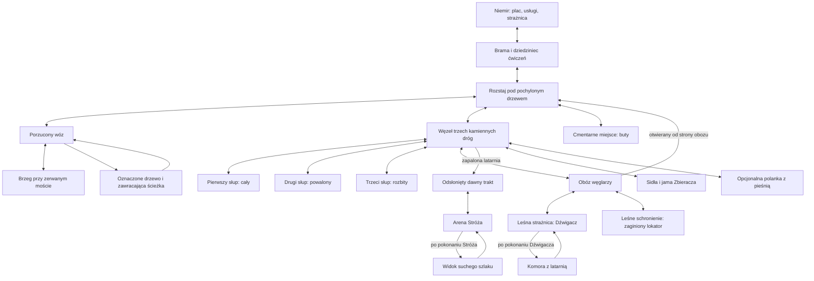

# Welesza — mapa ciągłego świata doliny Niemiru (v0.2)

**Status: [DECYZJA AUTORA] ZAAKCEPTOWANA PODSTAWA DO GREYBOXU** (27 października 2026 r.). Metry i ostateczna geometria powstaną w greyboxie; anomalia: wariant B; mechanizm latarni do decyzji ([VARIANTS.md](VARIANTS.md)).
**Zakres:** cała mapa **obecnie opisanego grywalnego świata (demo / pierwszy rozdział)**: Niemir, wszystkie leśne trasy, trzy słupy, obóz węglarzy, leśne ruiny, bossowie, cztery zadania poboczne, wyjście z doliny. Nie projektujemy na siłę dalszych krain pełnej gry, bo nie ma jeszcze zatwierdzonej fabuły poza suchym szlakiem.
**Warunek autorski:** brak ekranów ładowania podczas przemieszczania, także pomiędzy bramą, lasem, ruinami i komorą latarni.

> **v0.2 — korekta po review PM.** Topologia znanego demo zaakceptowana przez autora; bez zatwierdzonych metrów, anomalii ani mechanizmu latarni.
> Pierwszy wóz: **przed zmierzchem**, następnie nocleg i powrót rano.
> Mapa SVG przedstawia jedynie opcję **A** dla anomalii; opis B: [VARIANTS.md](VARIANTS.md).

## 1. Dostarczone materiały

- [Wizualna mapa topologiczno-przestrzenna SVG](WORLD_MAP.svg) oraz [podgląd PNG](WORLD_MAP.png) — czytelny plan obszarów.
- [Dane geograficzne świata, 28 punktów i 30 tras](world-layout.v0.2.json) (kotwice i sektory przecięte).
- [Karty 12 sektorów produkcyjnych](SECTORS.md).
- [Kontrakt techniczny bezszwowego świata i savegame](STREAMING.md).
- [Porównanie pętli A/B i odsłonięcia traktu](VARIANTS.md).
- [Plan pierwszego greyboxu](GREYBOX.md).

**Ważne:** wszystkie pozycje należą do **abstrakcyjnej siatki projektowej**; to nie zatwierdzone metry, rozmiary colliderów, czas dojścia ani skala postaci. Ostateczne proporcje powstaną po próbach kamery i walki.

## 2. Filozofia przestrzeni

Niemir jest jedynym prawdziwie bezpiecznym schronieniem. Drogi nie tworzą dużego przypadkowego proceduralnego otwartego świata. Las jest gęsty i pamiętny, ale ma logiczną topografię. Główne przejścia łączą niewielkie polany; boczne ścieżki prowadzą do rzeczywistych śladów ludzkiego życia, nie do zbędnych kopii nagród. Gracz stale widzi i rozumie fragment przestrzeni, ale nie dostaje od początku mapy ujawniającej tajemnice.

Podróż gracza jest wizualnie ciągła, **nie przesądzamy jednak liczby scen czy architektury silnika**. Nie ma widocznej „bramy poziomu”. Gdy za zakrętem wczytuje się dalsza część lasu, gra działa normalnie. Nie należy mylić granic `S00–S23` z granicami grywalnej mapy.

## 3. Główne rejony i szlak narracyjny

| Rejon | Stan i charakter | Cel gracza / rola | Ważne wejścia |
|---|---|---|---|
| **Niemir** | Palisada, skała ze źródłem, mały plac, dom kupca ze składem, dom gościnny, kuźnia, zielarka, strażnica, domy | Schronienie, przygotowania, sklep, rozmowy i zapalenie lampy | Jedyna brama → rozstaj |
| **Skraj i wóz** | Błotnisty trakt, koń i pakunki, dalszy zerwany most; dwa obejścia wozu | Prolog, pierwsza wyprawa, Pies, Powrotnik, księga przewozowa | Rozstaj → wóz → brzeg |
| **Rozstaj i anomalia** | Charakterystyczne pochylone drzewo, w pobliżu dawne wyjście z anomalią (wariant B, pierwszy raz przy wozie) | Utrata orientacji, powrót do punktu startowego; boczne cmentarne miejsce | Wóz ↔ rozstaj ↔ kamienie |
| **Kamienne wyjścia** | Trzy różnie zniszczone słupy, Korzeniec, ślady zawracającej drogi | Zadanie „Droga, która wraca”, dowolna kolejność inspekcji | Rozstaj ↔ kamienie ↔ obóz |
| **Obóz węglarzy** | Zimne palenisko, narzędzia, Drwal i Łucznik, leśne schronienie | Podejście do strażnicy, opcjonalne zadania; odblokowanie skrótu | Kamienie ↔ obóz ↔ Dźwigacz |
| **Leśna strażnica** | Niskie kamienne ruiny i zimny piec, Dźwigacz, schody do komory | Boss, zdobycie zgaszonej latarni, powrót do osady | Obóz → arena → komora |
| **Odsłonięty trakt** | Dawne słupy i nieprzebyta wcześniej droga | Dostęp dopiero po zapaleniu lampy w Niemirze | Kamienie → trakt → Stróż |
| **Finał** | Arena Stróża, następnie kawałek suchej drogi | Pokonanie strażnika, potwierdzenie wyjścia, powrót do osady | Stróż ↔ suchy szlak |
| **Odnogi poboczne** | Buty, sidła, jama Zbieracza, schronienie, pieśń, narzędzia | Cztery zadania poboczne i jedno spotkanie obserwacyjne | Od węzłów R, K i obozu |

**Start fabuły:** **przed zmierzchem** przy porzuconym wozie, bez wymuszonej walki. Bohater kieruje się światłem ku bramie. Następnego ranka wraca do wozu i zaczyna pierwszą wyprawę bojową.

### Schemat połączeń

Schemat jest topologiczny: pokazuje relacje, nie gotowy kształt terenu, skalę ani kierunki geograficzne.

Niemir jest punktem przygotowania, odpoczynku i rozliczenia. Drogę do finału otwiera latarnia zapalona w strażnicy osady, nie sam fakt podniesienia pustej lampy w ruinach. Powrót z latarnią korzysta ze skrótu przy obozie.

### Obie strażnice

- **ZON-straznica-niemir:** budynek wewnątrz osady, wspólna latarnia, Wszebora, bezpieczeństwo. Kamienny fundament, lekka drewniana góra, mała sylwetka pionowa.
- **ZON-straznica-lesna:** zrujnowany obiekt przy dawnym trakcie; piec, Dźwigacz i komora przenośnej latarni. Ciężka, niska sylwetka przerwana zawalonym murem.
- Arena Stróża znajduje się dalej przy tym samym kompleksie dawnych ruin, ale dochodzi się do niej odsłoniętą drogą między słupami. Nie ma dostępnej wcześniej szczeliny z komory do końca demo.

Nie ustanawiamy jeszcze wspólnego budowniczego ani daty powstania obiektów.

### Karty obszarów lasu

Wymiary są funkcjonalne, nie w metrach. Zasady rozmiaru: „Metryki do projektu z prostych brył” niżej.

| ID / miejsce | Cel, wejście i wyjścia | Narzędzia przestrzenne i slot spotkania | Prowadzenie / intensywność |
|---|---|---|---|
| ZON-rozstaj | Brama, wóz, kamienie, cmentarne miejsce, późniejszy skrót z obozu | Szeroki węzeł bez stałego starcia; widoczne rozdzielenie kierunków | Pochylone drzewo, w tle światło bramy; 1 |
| ZON-woz | Rozstaj ↔ brzeg; pętla ścieżki wraca do wozu | Otwarty plac wokół wozu, dwie drogi obejścia, slot ENC-woz | Koń, koło i jasny pakunek widoczne przed wrogami; 2–3 |
| ZON-brzeg | Odnoga od wozu, powrót tą samą drogą | Złamany most, bez skoku nad wyrwą i bez wymaganej walki | Szum wody i widoczny drugi przyczółek; 1 |
| ZON-petla | Wóz → oznaczone drzewo → ten sam wóz | Krótka, rozpoznawalna pętla; bez losowego przestawiania mapy | Ten sam znak nacięcia i ten sam rekwizyt wozu; 2 |
| ZON-kamienie | Rozstaj ↔ trzy odnogi ze słupami ↔ obóz i odnogi poboczne | Każdy słup ma dojście z boku; slot ENC-kamienie nie blokuje wszystkich śladów | Odmienny stan każdego słupa; 2–3 |
| ZON-oboz | Kamienie ↔ ruiny; schronienie i otwierany skrót | Stos drewna dzielący linię ostrzału, oba boki drożne; ENC-oboz | Dym resztkowy, nie wesołe ognisko; 3 |
| ZON-straznica-lesna | Obóz ↔ arena Dźwigacza ↔ komora po zwycięstwie | Dwa obejścia filara; boss ma przejście po obu stronach | Piec i ruch nosidła; 4 |
| ZON-komora | Strażnica leśna; bez alternatywnego wyjścia za Stróża | Krótka, bezpieczna nagroda po walce | Zimna lampa, ciała zwrócone do zamurowanego przejścia; 1 |
| ZON-dawny-trakt | Węzeł kamieni ↔ arena Stróża, dostęp z zapaloną latarnią | Proste dojście na finał bez obowiązkowej powtórki wrogów | Słupy wyłaniające się ze światła; 2 |
| ZON-stroz | Dawny trakt ↔ suchy szlak po zwycięstwie | Arena opisana w pakiecie 03; brak ślepych wnęk i nieosiągalnych półek | Poprzecznie trzymane drzewce; 5 |
| ZON-suchy-szlak | Krótki odcinek za Stróżem; powrót do osady znaną drogą | Punkt potwierdzenia odkrycia, nie nowa mapa świata | Twarde podłoże i dalsza droga niknąca za drzewami; 1 |

Rozstaje mają rozpoznawalne sylwetki. Nie dekorujemy wszystkich identycznymi słupami, latarniami i zwłokami: wyjątkowe znaki muszą zachować znaczenie.

### Odnogi poboczne

| Odnoga | Początek / powrót | Zawartość i nagroda | Niezależność |
|---|---|---|---|
| ZON-cmentarne-miejsce | Rozstaj ↔ miejsce przy leśnej skale | „Nie pal jego butów”; przedmiot i wiadomość, nie obowiązkowy miniboss | Żaden element nie otwiera głównej drogi |
| ZON-sidla i ZON-jama | Kamienie ↔ ślady sideł ↔ Zbieracz | „Puste sidła”; odzyskanie zapasów i rozliczenie z łowczynią Wojsławą [DECYZJA AUTORA, 28.10.2026] | Finał możliwy bez walki |
| Narzędzia przy obozie | Odgałęzienie na trasie przez obóz, powrót przy skrócie | „Żelazo pod korą”; narzędzia i usługa Radosta | Dźwigacz nie wymaga naprawy ani zakupu nowej broni |
| ZON-schronienie | Obóz ↔ mały szałas bez nowego lochu | „Trzeci przy stole”; odnalezienie Uniegosta, rozmowa i prywatna izba | Nie jest źródłem jedynej wskazówki o latarni |
| ZON-piesn | Kamienie ↔ niewielka polanka, powrót tą samą ścieżką | ENC-piesn, ślad i przygotowane drobne znalezisko | Bez nowego zadania wymaganego do ukończenia demo |

Odnaleziony Uniegost wraca do gospody po rozmowie po zakończeniu bezpośredniego zagrożenia; nie projektujemy dodatkowej eskorty z własną śmiercią NPC. Przedmioty znalezione wcześniej są rozpoznawane przy późniejszym przyjęciu zadania.

### Droga główna i powroty

1. **Podejście:** prolog przy wozie → brama → nocleg.
2. **Pierwsza wyprawa:** poranna informacja o moście → bezpieczna próba sterowania → wóz → odzyskanie pakunków i obserwacja pętli → powrót.
3. **Badanie lasu:** trzy słupy w dowolnej kolejności → ślady rozbicia → rozmowa z Borzętą. Rozmowa daje kontekst, a nie niewidzialny zamek uniemożliwiający wcześniejsze odwiedzenie obozu.
4. **Dłuższa wyprawa:** obóz → Dźwigacz → komora z latarnią → skrót od strony obozu → Wszebora i zapalenie lampy w Niemirze.
5. **Finał:** kamienie → odsłonięty trakt → Stróż → potwierdzenie suchej drogi → powrót z wiadomością.

**Zasada powrotu [DECYZJA AUTORA, 28.10.2026]:** po przejściu lochu lub dłuższej odnogi gracz nie wraca tą samą, już pustą drogą. Otwiera się krótsze, alternatywne przejście do początku wyprawy (bliżej osady lub rozstaju), przy którym może leżeć drobna nagroda. Wzorem jest Skyrim; skrót od strony obozu jest pierwszym przykładem.

Przejścia wymagane: pokonany Dźwigacz otwiera komorę; latarnia zapalona w osadzie odsłania trakt; pokonany Stróż otwiera suchą drogę. Żaden z tych warunków nie zależy od losowego łupu, pobocznego bossa, zużywalnej pochodni ani poziomu umiejętności.

Pętla lasu działa tylko na wyraźnie wskazanym dawnym wyjściu. Nie przenosi bohatera podczas walki, nie resetuje zapasów ani wrogów, nie odbiera kursora i nie usuwa znaku na drzewie. Odkryta ścieżka powrotna do osady pozostaje stabilna.

### Metryki do projektu z prostych brył

Najpierw należy zmierzyć w prototypie: D — średnicę kolizji bohatera, B — największy obrys lokalnego przeciwnika, U — pełny dystans uniku, A — zasięg jego groźnego ataku, V — widoczny obszar podłoża w kamerze. Nie ustalamy metrów przed tym pomiarem.

- Zwykłe drzwi: przejście większe niż D z marginesem dla sterowania kliknięciem; brak zaczepiania o dekoracje.
- Przejścia używane do omijania bossa: większe niż B z marginesem na obrót i nawigację, po obu stronach przeszkody.
- Pole nauki uniku: pełny tor U plus bezpieczny obszar startu i zakończenia; żadnego drzewa kończącego pierwszy odskok.
- Arena: umożliwia wyjście poza A pełnym lub częściowym U; nie wymaga podwójnego uniku jako jedynej odpowiedzi. Jeśli zmienimy U, wracamy do testu areny.
- Wóz i stos drewna: faktyczna kolizja zatrzymuje również pociski; droga obejścia jest dostępna dla odpowiedniego przeciwnika.
- Walka musi mieścić czytelną zapowiedź w V. Kamera i odsłanianie koron drzew są częścią projektu, nie kosmetyką.
- Głębokie urwiska są granicą terenu. Nie dodajemy skoku, wspinania ani obrażeń od upadku do wymagań pierwszej wyprawy.

Warunki odbioru mają wykazać brak klinowania ruchu, dostępność obu obejść i widoczność zapowiedzi.

## 4. Mapa na jednym płótnie

[Otwórz mapę SVG](WORLD_MAP.svg) — wszystkie 28 punktów oznaczono numerami w legendzie. Kotwice przypisane do sektorów są w JSON i [kartach sektorów](SECTORS.md). Północ na górze, wschód po prawej: **umowne**, do zatwierdzenia po greyboxie. Plansza ma 24×18 abstrakcyjnych komórek. Proponowane makrosektory grupują po 6×6, co daje **4 kolumny × 3 rzędy**. Puste fragmenty mapy są naturalnymi skarpami, zbiornikami wody lub zamkniętym lasem, a nie miejscem do automatycznego generowania setek przeciwników.

Ruch odbywa się płynnie przez każdy zwornik. Możliwość obejścia obiektu i wycofania się do osady ważniejsza jest od symetrycznych ścieżek na papierze.

## 5. Stan fabuły i bramki — rozwiązanie wizualne otwarte

| Warunek | Co odblokowuje | Jak zachować ciągłość |
|---|---|---|
| Pokonanie Dźwigacza | Schody/komorę z latarnią | Odsunięty zawalony element / dostępne schody w tej samej bryle ruin |
| Latarnia wyniesiona do Niemiru i zapalona | Widoczny/stabilny dawny trakt | Brama fabularna jest stała; czy samo światło ujawnia drogę, czy ustępuje przeszkoda — do decyzji autora (VARIANTS.md) |
| Otworzenie bariery od strony obozu | Skrót z obozu do rozstaju | Stała usunięta blokada przejścia, nie instant teleport |
| Pokonanie Stróża | Odcinek suchego szlaku | Otwarte przejście za areną, bez fade-to-black |
| Zbadanie suchego szlaku i powrót | Finał w Niemirze | Gracz fizycznie wraca odkrytymi drogami |

Trzy kamienne słupy w dowolnej kolejności. Nie wymagamy zabicia każdego napotkanego stwora, by zbadać ślady. Zbieracz i Żałobnica nie stanowią ukrytych wymagań dla głównego finału.

## 6. Szwy i logiczne zasady projektowania

- Pierwsza walka przy wozie: czytelny dystans skoku Psa, wolny pełen unik **U** i obie flanki wozu. Nie tworzyć schronienia, z którego da się bezkarnie atakować przez drewno.
- Kamienie: każda odnoga powinna mieć własną formę słupa i otwarte miejsce inspekcji. Wrogowie nie mogą „trzymać” wszystkich trzech słupów z jednego punktu.
- Obóz: stos drewna naprawdę odcina linię ostrzału, ale nie blokuje obu przejść. Drwal i Łucznik działają jako jeden kontrolowany encounter.
- Dźwigacz: przy piecu dwa obejścia, bez klinowania szerokiego potwora; gracz może powrócić do obozu i osady.
- Stróż: pole walki nie może być jednowymiarowym tunelem; wyraźny obrys zagrożenia, żadnych nieosiągalnych wysepek i dodatkowych fal.
- Prolog i osada: warstwy dachu i wysokie drzewa nie mogą całkowicie ukryć bohatera. Jedna główna brama i rozpoznawalna skała ze źródłem.
- Granica mapy: urwisko/potok/gęstwina to uzasadnione przeszkody. Unikać szerokich widocznych ścieżek prowadzących do niewidzialnej ściany.

## 7. Podział prac na chunki — kolejność PRODUKCJI, nie loadingu

| Pakiet | Zakres do zaprojektowania i przetestowania | Kryterium odbioru |
|---|---|---|
| **WLD-00** | Zasady globalnej mapy, skala, kamera, nawigacja, identyfikatory | Spójna nawigacja i identyfikatory; technologia współrzędnych do ustalenia |
| **WLD-01** | S01: Niemir (brama, plac, źródło, gospoda, trening) | Bez pomyłki od bramy do Miłki/Żegoty |
| **WLD-02** | S01 + S10 + S11: rozstaj, wóz, most, pętla, cmentarne miejsce | Pierwsza wyprawa i powrót, obejścia i anomalia |
| **WLD-03** | S11 + S12 + S21: trzy słupy, Korzeniec, polanka z pieśnią | Dowolna kolejność śladów, brak zablokowanych skrótów questowych |
| **WLD-04** | S12 + S02: obóz, narzędzia, schronienie, skrót | Drwal/Łucznik i dwukierunkowe przejście po otwarciu |
| **WLD-05** | S13: Dźwigacz, piec, komora z latarnią | Ciągłe zejście schodami, powrót bez przerwania gry |
| **WLD-06** | S12 + S13; S23 wyłącznie tło: dawny trakt, Stróż, sucha droga | Finał i poprawne ustawienie wszystkich bramek |
| **WLD-07** | S21 + S22 + tło: sidła, Zbieracz, polana, podmokłości | Poboczne miejsca mają sensowny powrót i nie blokują głównego szlaku |
| **WLD-08** | Integracja 12 sektorów, streaming, zapis, profilowanie | Brak pauz przy szwach, poprawna trwałość stanu i zero podwójnych obiektów |

**Pierwszy grywalny pionowy wycinek** = WLD-00 + WLD-01 + WLD-02. Pozostałe sektory mogą być najpierw blokowane naturalnymi przeszkodami. Muszą zachować ciągłe przejście **odczuwane przez gracza**, także jeśli silnik użyje wielu scen lub osobnych zasobów.

## 8. Otwarte kwestie przed detalowaniem geometrii

1. Kamera: stała izometria 2:1 bez obrotu ([SILNIK.md](../SILNIK.md)).
2. Silnik: Godot 4, gra 2D ([decyzja warunkowa](../SILNIK.md)). Reprezentacja podłoża i fizyki — otwarte.
3. Wymiary świata — dopiero po ustaleniu D, B, U, A, V w walce.
4. Anomalia: **wariant B** (decyzja autora), odczuwany przez rozjazd mapy bohatera; rysunek zachowuje polilinię A tylko jako makietę: [porównanie](VARIANTS.md).
5. Jak szczegółowe i grywalne mają być wnętrza gospody i strażnicy? Na razie pełne bezładowaniowe wnętrza są obowiązkiem tylko wtedy, gdy gracz faktycznie do nich wchodzi.
6. Dalsza pełna gra po suchym szlaku **nie ma jeszcze opisanego regionu**. Granica demo ma być przygotowana na przyszłą ekspansję bez zmiany fundamentu mapy, ale nie deklarować lokacji bez kanonu.

## 9. Podstawa i zgodność z repozytorium

- [Koncepcja i zaakceptowana fabuła demo](../fabula.md).
- [Niemir, początek gry i plac przy wozie](../mapa-demo.md).
- [Spotkania i bossowie](../przeciwnicy.md).
- [Dane grafu istniejącego demo](../graphs/layout-demo.json).
- [Dane pierwszej wyprawy](../graphs/layout-first-expedition.json).

Nie zmieniamy nazw i treści uzgodnionych zadań ani NPC. Układ miejsc, tras i sektorów jest **zaakceptowaną podstawą do greyboxu**; współrzędne i długości tras mogą się zmienić po pomiarach w prototypie i nie ustanawiają nowych faktów fabularnych.

## 10. Zmiany i zgodność w v0.2

- 28 kotwic otrzymało `owner_sector`, 30 polilinii `owner_sector` (koordynator) i `sectors_crossed` (faktycznie odwiedzone obszary); 11 dróg przecina przynajmniej jedną granicę.
- Pierwszy słup należy do S11, powalony i rozbity do S12, suchy szlak do S13. S23 to **tło**, nie właściciel końca gry. Nie ruszaliśmy ich współrzędnych.
- Skorygowana pora pierwszego spotkania wozu — przed zmierzchem.
- Anomalia: wariant B; latarnia L1/L2/L3 pozostaje wariantem autorskim, bez zmiany bramek głównych zadań.
- W projektowym grafie dopuszczamy różne rozwiązania techniczne streamingu, bez widocznych ekranów ładowania podczas zwykłej podróży.
- Rysunek pozostaje topologią — obie trasy obejścia wozu są problemem lokalnej geometrii wg [placu przy wozie](../mapa-demo.md), a nie dwiema nowymi krawędziami między węzłami świata.
